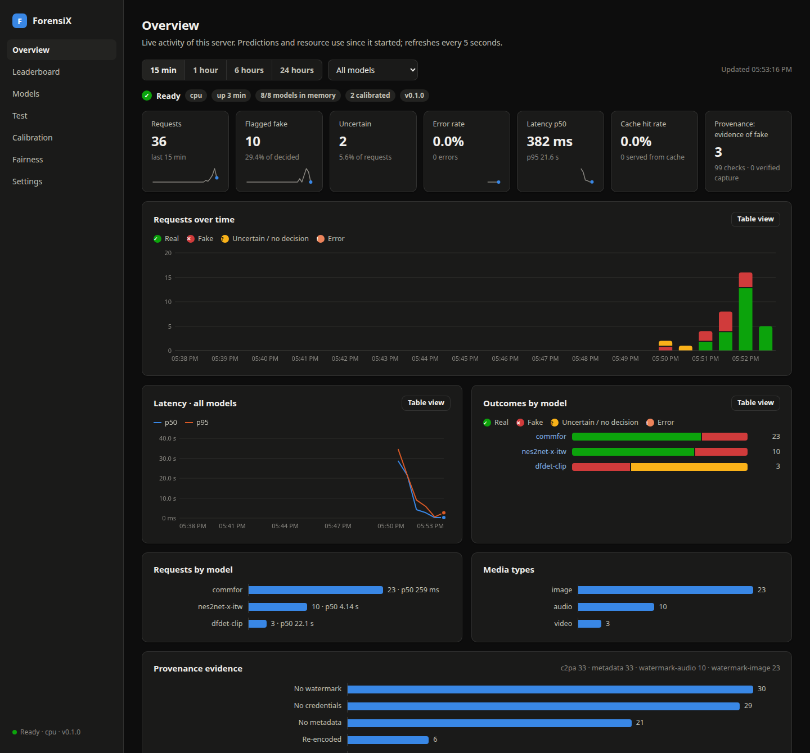
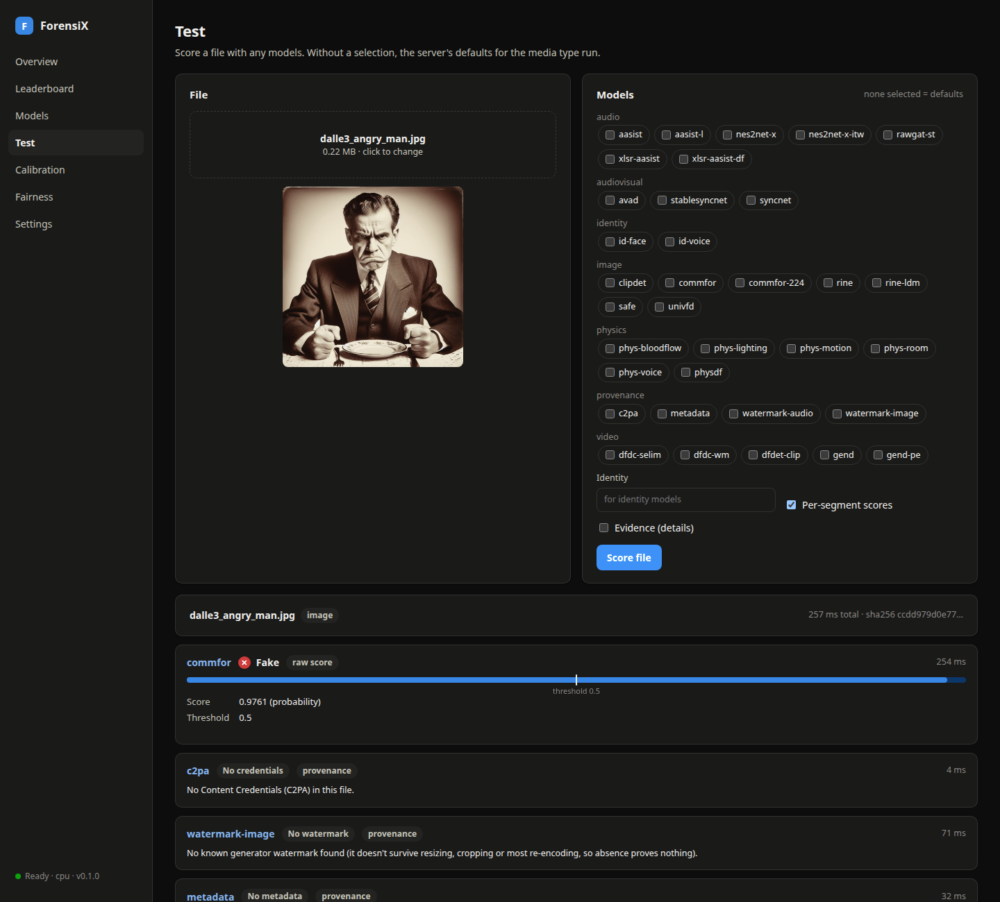
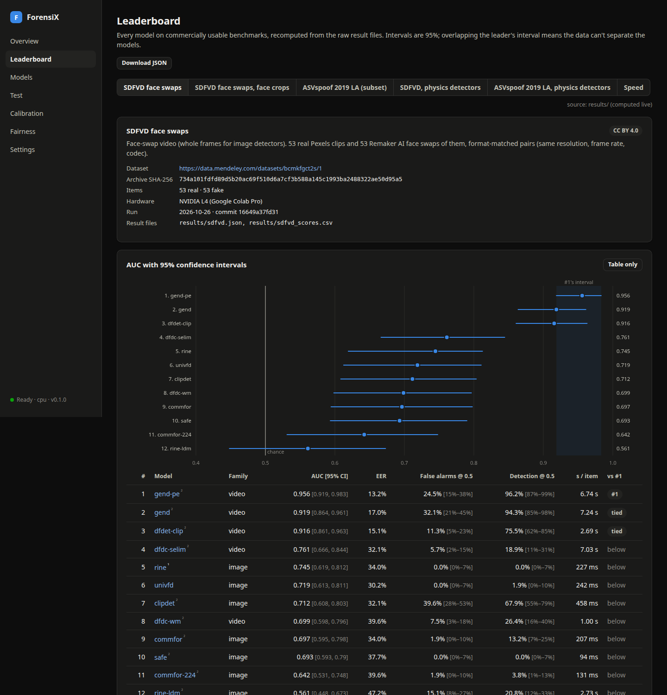
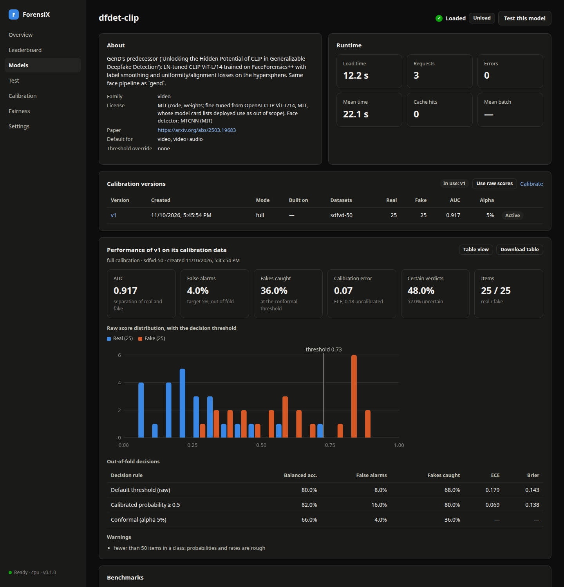
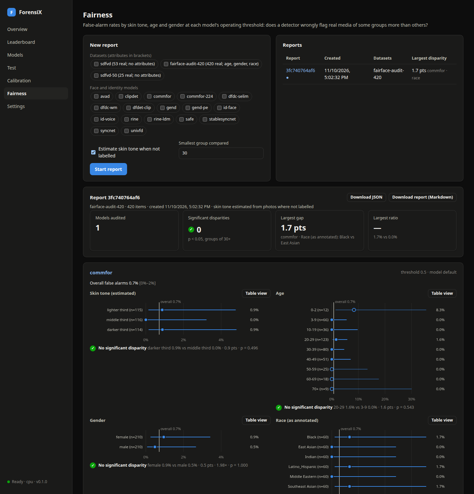
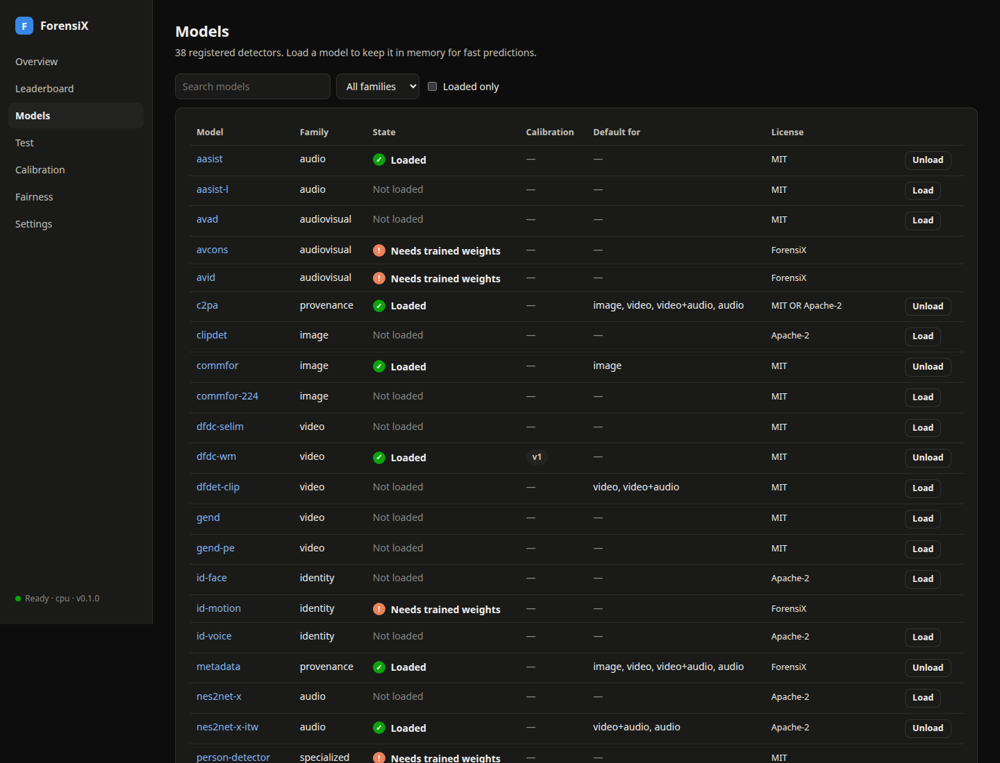
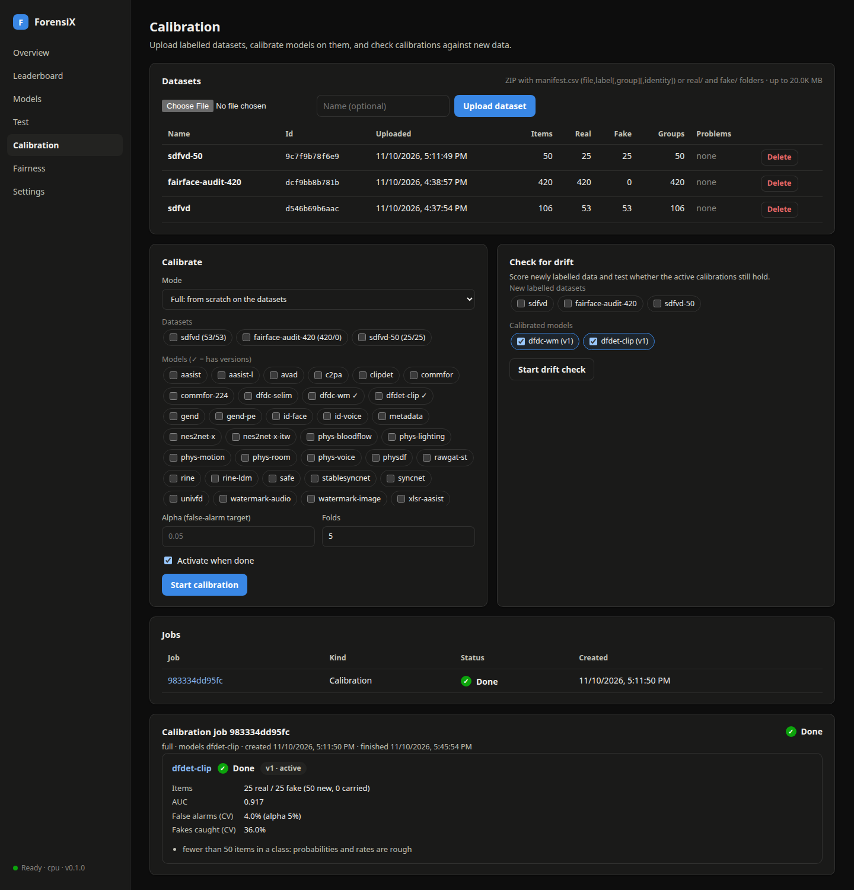

# ForensiX

[](https://colab.research.google.com/github/anas-rz/ForensiX/blob/main/notebooks/ForensiX_Get_Started.ipynb) [](https://anas-rz.github.io/ForensiX/)

A PyTorch model zoo for **deepfake detection and multimodal media forensics**: audio, video, audiovisual, multimodal, physics-based, image, identity-based and graph-based detectors behind one Python API.

All bundled models and weights are under **commercially usable licenses**.

**Get started:** [open the Colab notebook](https://colab.research.google.com/github/anas-rz/ForensiX/blob/main/notebooks/ForensiX_Get_Started.ipynb) to detect, calibrate, evaluate and run the web manager on a free GPU, with no install. Or read the [documentation](https://anas-rz.github.io/ForensiX/).

It ships with an HTTP server and a web manager for testing, calibrating and monitoring the detectors:



<table>
  <tr>
    <td width="50%"><br><b>Test</b>: score an image, video or audio file with any models; provenance checks show what the file itself proves.</td>
    <td width="50%"><br><b>Leaderboard</b>: every model on commercially usable benchmarks, with 95% confidence intervals.</td>
  </tr>
  <tr>
    <td><br><b>Models and calibration</b>: calibrate a model on your own labelled data and see how each version performs.</td>
    <td><br><b>Fairness</b>: false-alarm rates by skin tone, age and gender, with intervals and significance tests.</td>
  </tr>
  <tr>
    <td><br><b>Models</b>: every registered detector, its license and state; load or unload it.</td>
    <td><br><b>Calibration jobs</b>: full, incremental and refit calibrations with before/after reports.</td>
  </tr>
</table>

## Install

```bash
pip install -e ".[dev]"
python scripts/download_weights.py          # optional: pre-fetch all weights
```

Weights are cached in `~/.cache/forensix` (override with `FORENSIX_CACHE`) and checked against a SHA-256 hash. `forensix.load()` downloads them automatically on first use.

## Leaderboard

Every model on commercially usable benchmarks (SDFVD face swaps, ASVspoof 2019 LA; Deepfake-Eval-2024 and the ForensiX image set pending), with AUC 95% confidence intervals, false-alarm and detection rates at a fixed threshold, and speed: [LEADERBOARD.md](LEADERBOARD.md). It's recomputed from the raw results by `python scripts/build_leaderboard.py`, and also shown in the web manager.

## Documentation

The documentation is published at **[anas-rz.github.io/ForensiX](https://anas-rz.github.io/ForensiX/)**. To try everything without installing, use the [Colab notebook](https://colab.research.google.com/github/anas-rz/ForensiX/blob/main/notebooks/ForensiX_Get_Started.ipynb).

Start with the [Quickstart](docs/getting-started.md): install, score a file in Python, run the server and use the web manager. [docs/](docs/README.md) also has the [concepts](docs/concepts.md), the [API reference](docs/api-reference.md), [recipes](docs/recipes.md) for common tasks, [guides](docs/README.md#guides) (choosing detectors, interpreting scores, evaluation, identity, physics, training, Colab, extending, licensing), the [HTTP server](docs/server.md), [calibration](docs/calibration.md), [provenance](docs/provenance.md), [fairness reports](docs/fairness.md), and [deployment at scale](docs/deployment.md).

The site is built from these pages with [MkDocs](https://www.mkdocs.org/) and deployed by `.github/workflows/docs.yml` on every push to `main`. To preview it locally:

```bash
pip install -e ".[docs]"
mkdocs serve        # http://127.0.0.1:8000 (add -a 127.0.0.1:8001 if the ForensiX server is on 8000)
```

## Provenance

Next to the detectors, ForensiX reads the evidence a file carries: C2PA Content Credentials (tampering after signing, declared AI generation, trusted capture), the invisible watermarks of Stable Diffusion 1.x/2.x/SDXL/SVD and Meta's AudioSeal, and generator, editing and re-encoding traces in metadata. A found watermark or signed AI declaration is stronger evidence than any score; its absence proves nothing.

```python
report = forensix.provenance.check("upload.jpg")   # pip install -e ".[provenance]"
report["verdict"], report["label"], report["summary"]
```

See [docs/provenance.md](docs/provenance.md).

## HTTP server

```bash
pip install -e ".[server]"
python -m forensix.server --device cuda --preload dfdet-clip commfor nes2net-x-itw syncnet
curl -F file=@clip.mp4 -F models=dfdet-clip,syncnet http://localhost:8000/v1/detect
```

Models stay loaded between requests, concurrent image and audio requests are batched, and results are cached by file hash. See [docs/server.md](docs/server.md). The server also hosts a web manager at `http://localhost:8000/ui/` for testing, loading, calibrating and monitoring models ([docs/ui.md](docs/ui.md)).

Containers: `docker compose up -d --build` runs the server and manager locally, and `kubectl apply -k deploy/kubernetes/overlays/cpu` (or `gpu`) deploys a manager plus autoscaled inference replicas. See [docs/cloud.md](docs/cloud.md). Each cloud deploys with one command or one click (a GitHub Actions workflow):

| Cloud | Command | Guide |
|---|---|---|
| AWS | `deploy/aws/deploy.sh ecs` (or `ecs-gpu`, `eks`, `eks-gpu`) | [docs/aws.md](docs/aws.md) |
| Google Cloud | `deploy/gcp/deploy.sh cloudrun` (or `cloudrun-gpu`, `gke`, `gke-gpu`) | [docs/gcp.md](docs/gcp.md) |
| Azure | `deploy/azure/deploy.sh aca` (or `aca-gpu`, `aks`, `aks-gpu`), or [](https://portal.azure.com/#create/Microsoft.Template/uri/https%3A%2F%2Fraw.githubusercontent.com%2Fanas-rz%2FForensiX%2Fmain%2Fdeploy%2Fazure%2Fcontainerapps.json) | [docs/azure.md](docs/azure.md) | Benchmark results are in [benchmark.md](benchmark.md).

## Usage

```python
import forensix

forensix.list_models()                 # ['aasist', 'aasist-l', 'nes2net-x', 'nes2net-x-itw', 'rawgat-st', ...]
forensix.list_models("audio")
forensix.info("aasist")                # license, source, paper, description

detector = forensix.load("aasist")     # device="cuda" for GPU
pred = detector.predict("clip.flac")   # any format libsndfile reads (wav, flac, ogg, mp3)
pred.fake_prob, pred.label             # 0.97, 'fake'
pred.segment_fake_probs                # per-4s-window scores for long clips

detector.predict(waveform, sample_rate=44100)       # numpy array input
detector.predict_batch(["a.wav", "b.wav"])

forensix.load("aasist", weights_path="my_finetuned.pth")  # your own checkpoint
```

Image detectors work the same way:

```python
detector = forensix.load("univfd")
detector.predict("photo.png").fake_prob     # path, PIL image or (H, W, 3) uint8 array
detector.predict_batch(["a.jpg", "b.png"])
```

Images are never resized or re-encoded before the model's own preprocessing, because the traces these detectors look for don't survive resampling or compression.

Video detectors take a file path:

```python
detector = forensix.load("dfdc-selim")
pred = detector.predict("clip.mp4")
pred.fake_prob, pred.segment_fake_probs    # video score, per-face scores
```

Audio-visual detectors take a video with an audio track (requires ffmpeg):

```python
pred = forensix.load("avad").predict("talking_head.mp4")
pred.fake_prob, pred.score_type     # 0.14, "anomaly" (higher = more likely fake)
```

Audio is converted to mono and resampled to 16 kHz. Clips longer than the model window (4.04 s) are split into windows and the window scores are averaged. `fake_prob` is the softmax output and is **not calibrated**, so pick thresholds per model.

## Models

| Family | Name | License | Params | Trained on | Published EER | Subset EER, upstream scores | Subset EER, ForensiX |
|---|---|---|---|---|---|---|---|
| audio | `aasist` | MIT | 297K | ASVspoof 2019 LA | 0.83% (2019 LA eval) | n/a | 1.6% |
| audio | `aasist-l` | MIT | 85K | ASVspoof 2019 LA | 0.99% (2019 LA eval) | n/a | 1.4% |
| audio | `rawgat-st` | MIT | 441K | ASVspoof 2019 LA | 1.06% (2019 LA eval) | 1.30% | 3.1%¶ |
| audio | `xlsr-aasist` | MIT* | 316M | ASVspoof 2019 LA | 0.82% (2021 LA eval) | n/a | 0.4% |
| audio | `xlsr-aasist-df` | MIT* | 316M | ASVspoof 2019 LA | 2.85% (2021 DF eval) | n/a | 0.0% |
| audio | `nes2net-x` | Apache-2.0 | 316M (512K back end) | ASVspoof 2019 LA | 1.49% (2021 DF), 1.88% (2021 LA) | n/a | 0.2% |
| audio | `nes2net-x-itw` | Apache-2.0 | 316M (512K back end) | ASVspoof 2019 LA | 5.15% (In-the-Wild) | n/a | 0.1% |

Subset: 1,000 bona fide + 77 trials per attack from the 2019 LA eval set (seed 0, 2,001 trials; `scripts/eval_asvspoof2019_la.py`, results in [results/asvspoof2019_la_subset.json](results/asvspoof2019_la_subset.json)).

¶ Upstream scores only the first 4.04 s of each clip; ForensiX averages over all 4.04 s windows. 415 of the 2,001 subset clips are longer. Scoring `rawgat-st` the upstream way in ForensiX gives 1.30%, the same as upstream's released scores, so the network and scoring match and the gap is the window averaging. The other audio models use the same averaging. `aasist` shows the same effect on the full 71,237-trial eval set: 0.82% EER scored the upstream way (published 0.83%), 1.58% with ForensiX's window averaging ([identity_benchmark.md](identity_benchmark.md)). On ASVspoof the averaging roughly doubles the EER; whether it helps on long real-world audio hasn't been measured.

**Image**

| Family | Name | License | Params | Trained on | Published result | ForensiX eval |
|---|---|---|---|---|---|---|
| image | `univfd` | MIT† | 304M (769 trainable) | ProGAN vs real (ForenSynths) | 93.4 mAP, 81.4% mean accuracy over 19 test sets (ProGAN + 18 unseen GAN, diffusion and other generators) | pending |
| image | `rine` | Apache-2.0† | 310M (6.3M trainable) | ProGAN, 4 classes (ForenSynths) | 98.8 mAP, 91.5% mean accuracy over 20 test sets (ProGAN + 19 unseen) | pending |
| image | `rine-ldm` | Apache-2.0† | 314M (10.5M trainable) | Latent Diffusion (DMID training set) | Synthbuster: 90.5 mAP, 87.5% mean accuracy over 9 generators (SDXL 99.8 AP; DALL-E 3 only 32.5 AP) | pending |
| image | `commfor` | MIT | 22M | Community Forensics: 2.7M images from ~4,800 generators (mostly SD derivatives) | 0.986 mAP, 92.3% mean accuracy over 6 benchmarks (Synthbuster 0.974 mAP) | pending |
| image | `commfor-224` | MIT | 22M | same, 224 input | 0.966 mAP, 88.9% mean accuracy over 6 benchmarks | pending |
| image | `safe` | Apache-2.0 | 1.4M | ProGAN (ForenSynths), from scratch | 96.7% ACC / 99.3 AP averaged over 33 test subsets from 26 generators; FLUX 99.3 / 99.9, PixArt 99.6 / 100 (authors' DiTFake) | pending |
| image | `clipdet` | Apache-2.0 | 303M (1,025 trainable) | 10k COCO real + 10k latent-diffusion, augmented | 90.0 mean AUC over 18 generators (GAN, diffusion, commercial tools); 85.2 on cropped/resized/compressed images | pending |

**Video**

| Family | Name | License | Params | Trained on | Published result | ForensiX eval |
|---|---|---|---|---|---|---|
| video | `dfdc-selim` | MIT‡ | 7 × 66M (ensemble) + MTCNN | DFDC training set | 1st place, Deepfake Detection Challenge: private-test log loss 0.4279; 65.18% accuracy | pending |
| video | `gend` | MIT†‡ | 303M | FaceForensics++ | 91.2% mean video-level AUROC over 14 cross-dataset benchmarks (CDFv2 94.6, DFDC 86.4; mean of 5 training seeds) | pending |
| video | `gend-pe` | MIT‡ | 316M | FaceForensics++ | 91.4% mean video-level AUROC over 14 cross-dataset benchmarks (CDFv2 95.0, DFDC 82.2; mean of 5 training seeds) | pending |
| video | `dfdet-clip` | MIT†‡ | 303M | FaceForensics++ | video-level AUROC: CDFv2 96.6, DFD 98.0, DFDC 87.2, FFIW 91.5, DeepSpeak v1 92.0 | pending |
| video | `dfdc-wm` | MIT‡ | 4 nets, 81M total (incl. RetinaFace) | DFDC training set | 2nd place, Deepfake Detection Challenge: private-test log loss 0.4284 |  pending |

**Audiovisual**

| Family | Name | License | Params | Trained on | Published result | ForensiX eval |
|---|---|---|---|---|---|---|
| audiovisual | `avad` | MIT*‡ | 41.6M + RetinaFace | real videos only (LRS2), self-supervised | FakeAVCeleb: 94.5 AUC averaged over the 4 fake-video categories; 71.6 AUC on fake audio with real video | LAV-DF test: AUC 0.563 ([av_benchmark.md](av_benchmark.md)) |
| audiovisual | `syncnet` | MIT*‡ | 13.6M + RetinaFace | real BBC television, self-supervised (sync vs. shifted audio) | no deepfake result in the paper (it reports AV offset and active-speaker accuracy) | LAV-DF test: AUC 0.722; 0.833 scoring the worst window ([av_benchmark.md](av_benchmark.md)) |
| audiovisual | `stablesyncnet` | OpenRAIL++-M§ (weights), Apache-2.0 (code)‡ | 401M + MediaPipe | real talking faces (VoxCeleb2, HDTF): synced vs. unsynced pairs | 94% sync accuracy on VoxCeleb2 and HDTF (LatentSync); no deepfake result | LAV-DF test: AUC 0.785; 0.853 scoring the worst window ([av_benchmark.md](av_benchmark.md)) |
| audiovisual | `avcons` | ForensiX (you train it) + SyncNet features (MIT*) | 4.0M + SyncNet + RetinaFace | real videos only (e.g. VoxCeleb2, CC BY 4.0), negatives made from them | ForensiX model; verified on synthetic embeddings | train on Colab |
| audiovisual | `avid` | ForensiX (you train it) + ECAPA-TDNN (Apache-2.0) + DINOv2 ViT-S/14 (Apache-2.0) | 0.4M heads + 20.8M ECAPA + 22M DINOv2 + RetinaFace | real videos only (e.g. VoxCeleb2, CC BY 4.0); ECAPA trained on VoxCeleb | ForensiX model; verified on synthetic identities | train on Colab |

`avad` and `syncnet` return an **anomaly score**, not a probability: `Prediction.score_type == "anomaly"`, and `threshold`, `is_fake` and `label` are `None`. Choose a threshold on your own data. AUC and AP are threshold-free.

**Physics (physdf)**: detectors that learn the physics of real faces and voices and flag violations. See [Physics-based detection](#physics-based-detection-physdf).

| Family | Name | License | Needs | Status |
|---|---|---|---|---|
| physics | `phys-bloodflow` | ForensiX + MediaPipe (Apache-2.0) | ≥ 6 s of a continuously visible face | signals verified on synthetic video; provisional priors |
| physics | `phys-motion` | ForensiX + MediaPipe (Apache-2.0) | ≥ 2 s of a tracked face at ≥ 20 fps (for the smoothness check) | signals verified on synthetic data; provisional priors |
| physics | `phys-lighting` | ForensiX + MediaPipe (Apache-2.0) + ICT-FaceKit (MIT) | ≥ 2 s of a tracked face | signals verified on synthetic relighting; provisional priors |
| physics | `phys-voice` | ForensiX (no model weights) | ≥ 1.5 s of voiced speech | estimators verified on synthetic speech; priors anchored on real speech; no false alarms on 10 real excerpts |
| physics | `phys-room` | ForensiX (no model weights) | ≥ 6 s of speech with pauses | verified on synthetic rooms and microphones; priors anchored on real speech; no false alarms on 10 real excerpts |
| physics | `physdf` | ForensiX + MediaPipe (Apache-2.0) + ICT-FaceKit (MIT); graph prior trained by you on real media | video with sound, video, or audio | pipeline verified end to end; graph prior verified on synthetic physics; train the real prior on Colab |

**Identity (reference-based)**: enroll a person from their photos, videos or voice recordings, then check whether new media really shows them. See [Identity-based detection](#identity-based-detection).

| Family | Name | License | Params | Checks | Status |
|---|---|---|---|---|---|
| identity | `id-face` | Apache-2.0‡ (SFace, OpenCV Zoo) + YuNet (MIT) | MobileFaceNet (39 MB ONNX) + YuNet (0.2 MB) | is the face the enrolled person? (99.40% on LFW, OpenCV Zoo threshold) | pipeline identical to OpenCV Zoo; verified on public-domain photos |
| identity | `id-voice` | Apache-2.0 (SpeechBrain ECAPA-TDNN) | 20.8M | is the voice the enrolled person's? (EER 0.80% on VoxCeleb1-test, cleaned; SpeechBrain) | ASVspoof 2019 LA eval: SV-EER 0.76%; SASV-EER 1.92% fused with `aasist` ([identity_benchmark.md](identity_benchmark.md)) |
| identity | `id-motion` | ForensiX (you train it) + MediaPipe (Apache-2.0) | 1.7M | does the person move like the enrolled person? (head motion and expressions; ID-Reveal idea) | verified on synthetic behaviour and a real clip; train on Colab |

‡ Training data: several image and video models were trained on data with non-commercial terms. UnivFD, RINE and SAFE used ForenSynths (CC BY-NC-SA 4.0), `clipdet` used COCO (mixed Flickr licenses), and Community Forensics used ImageNet, LAION and others. `avad` was trained on LRS2 and `syncnet` on BBC television (research-only terms); `stablesyncnet` on VoxCeleb2 (CC BY 4.0; video copyright stays with the owners) and HDTF (YouTube videos). `id-face` (SFace) was trained on CASIA-WebFace, VGGFace2 or MS-Celeb-1M (the release doesn't say which), all with research-only or non-commercial terms. There is no face-recognition model trained on commercially licensed data; SFace is the one whose weights carry an explicit commercial license (Apache-2.0). The video models were trained on DFDC (`dfdc-selim`, `dfdc-wm`) and FaceForensics++ (`gend`, `gend-pe`, `dfdet-clip`), both of which have research-only terms of use. ForensiX lists the licenses of the code and weights, which are what govern redistribution. Whether a training set's non-commercial terms carry over to the trained weights is legally unsettled; check with counsel for commercial deployment.

† For UnivFD the code and linear head are MIT, for RINE the code and trainable weights are Apache-2.0, and the video models `gend` and `dfdet-clip` are MIT and fine-tuned from the same CLIP. Their backbone is OpenAI CLIP ViT-L/14 (MIT license). OpenAI's model card lists "any deployed use case" as out of scope, which is an intended-use statement rather than a license term.

§ `stablesyncnet`'s weights are under the CreativeML Open RAIL++-M license. Commercial use is allowed, but the license's use-based restrictions (paragraph 5 and Attachment A, e.g. no use that violates the law, harms minors, or generates or spreads disinformation to harm others) apply, and you must pass them on to your users. Two of them matter for forensics: the weights may not be used for fully automated decision-making that adversely affects someone's legal rights, or to generate information for administration of justice, law enforcement, immigration or asylum processes. Don't use `stablesyncnet` in those settings; `syncnet` (MIT) covers the same check without these restrictions. The text is in [forensix/audiovisual/stablesyncnet/LICENSE-WEIGHTS-OpenRAIL++-M.txt](forensix/audiovisual/stablesyncnet/LICENSE-WEIGHTS-OpenRAIL++-M.txt).

\* The code is MIT. The weights (for `avad`, its synchronization model; for `syncnet`, hosted by the Oxford VGG group) are released by the authors through a link in the MIT repo's README, but they are hosted outside the repo and have no separate license of their own.

"Subset EER, upstream scores" is computed from the score files the authors released, restricted to our evaluation subset (see [Evaluation](#evaluation)). It's the number our own run should reproduce. With 1,000 bona fide trials the subset EER moves in 0.1-point steps.

- **AASIST**: Jung et al., *AASIST: Audio Anti-Spoofing using Integrated Spectro-Temporal Graph Attention Networks*, ICASSP 2022 ([paper](https://arxiv.org/abs/2110.01200), [code](https://github.com/clovaai/aasist)). The network code is vendored verbatim and its outputs match the upstream evaluation pipeline exactly. The upstream MIT license is in [forensix/audio/aasist/LICENSE](forensix/audio/aasist/LICENSE).
- **RawGAT-ST**: Tak et al., *End-to-End Spectro-Temporal Graph Attention Networks for Speaker Verification Anti-Spoofing and Speech Deepfake Detection*, ASVspoof 2021 Workshop ([paper](https://arxiv.org/abs/2107.12710), [code](https://github.com/eurecom-asp/RawGAT-ST-antispoofing)). This is the element-wise-multiplication fusion variant (`RawGAT_ST_mul`), the paper's best model. The network code is vendored verbatim and its outputs match upstream exactly. The license is in [forensix/audio/rawgat_st/LICENSE](forensix/audio/rawgat_st/LICENSE).
- **XLS-R + AASIST**: Tak et al., *Automatic speaker verification spoofing and deepfake detection using wav2vec 2.0 and data augmentation*, Odyssey 2022 ([paper](https://arxiv.org/abs/2202.12233), [code](https://github.com/TakHemlata/SSL_Anti-spoofing)). A wav2vec 2.0 XLS-R 300M front end (Apache-2.0) fine-tuned jointly with an AASIST back end, with RawBoost augmentation. `xlsr-aasist` is the LA-track checkpoint and `xlsr-aasist-df` the DF-track one; the DF one is the better choice for real-world, compressed deepfakes. Upstream depends on fairseq. ForensiX runs the front end with Hugging Face `transformers` and converts the checkpoint on load; the back end is vendored verbatim. Its outputs match the fairseq implementation (see [Verification](#verification)). The weights (1.2 GB each) are hosted on the authors' Google Drive, and inference takes about 1.3 s per 4 s window on CPU, so use a GPU. The license is in [forensix/audio/xlsr_aasist/LICENSE](forensix/audio/xlsr_aasist/LICENSE).
- **Nes2Net-X**: Liu et al., *Nes2Net: A Lightweight Nested Architecture for Foundation Model Driven Speech Anti-spoofing*, IEEE T-IFS 2025 ([paper](https://arxiv.org/abs/2504.05657), [code](https://github.com/Liu-Tianchi/Nes2Net_ASVspoof_ITW)). A 512K-parameter nested Res2Net back end on the same XLS-R front end as XLS-R + AASIST (the shared HF port lives in [forensix/audio/xlsr.py](forensix/audio/xlsr.py)). `nes2net-x` is the ASVspoof 2021 checkpoint (an average of 5 epochs) and scores 4 s windows. `nes2net-x-itw` is trained with validation augmentation for out-of-domain audio and scores whole utterances; clips over 30 s are split into 30 s chunks. It is the best choice for real-world audio. The upstream README releases the code and models under Apache-2.0 and welcomes commercial use. The repo has no LICENSE file, so ForensiX ships the Apache-2.0 text in [forensix/audio/nes2net_x/LICENSE](forensix/audio/nes2net_x/LICENSE), with our changes noted in the file header.
- **UnivFD**: Ojha et al., *Towards Universal Fake Image Detectors that Generalize Across Generative Models*, CVPR 2023 ([paper](https://arxiv.org/abs/2302.10174), [code](https://github.com/WisconsinAIVision/UniversalFakeDetect)). A linear classifier on frozen CLIP ViT-L/14 image embeddings. Following upstream evaluation, it scores the central 224×224 crop without resizing; smaller images are zero-padded. The backbone is loaded from Hugging Face `openai/clip-vit-large-patch14` at a pinned revision and shared with other CLIP-based detectors ([forensix/image/clip.py](forensix/image/clip.py)).
- **RINE**: Koutlis & Papadopoulos, *Leveraging Representations from Intermediate Encoder-blocks for Synthetic Image Detection*, ECCV 2024 ([paper](https://arxiv.org/abs/2402.19091), [code](https://github.com/mever-team/rine)). It combines the CLS tokens of all 24 CLIP ViT-L/14 blocks with learned per-block importance weights, then an MLP head. `rine` is the 4-class ProGAN checkpoint and scores the central 224×224 crop. `rine-ldm` is trained on latent-diffusion images and is the better choice for modern diffusion output. It averages logits over ten 224×224 crops, as upstream does on Synthbuster; images under 224 px are zero-padded, where upstream would raise an error. The trainable modules keep upstream's names, so the released checkpoints load unchanged. The block features come from hooks on the shared HF CLIP backbone. Upstream ran CLIP in fp16 on GPU, while ForensiX runs fp32, so scores can differ very slightly from the paper's.
- **Community Forensics**: Park & Owens, *Community Forensics: Using Thousands of Generators to Train Fake Image Detectors*, CVPR 2025 ([paper](https://arxiv.org/abs/2411.04125), [code](https://github.com/JeongsooP/Community-Forensics)). A plain ViT-S/16, initialized from timm's AugReg ImageNet-21k weights (Apache-2.0) and trained on images from about 4,800 generators. Unlike the CLIP-based models, it follows upstream in resizing the short side (to 440, or 256 for `commfor-224`) before center-cropping 384 (or 224). Weights come from the authors' Hugging Face repos (MIT) at pinned revisions. Its training set covers a wide range of Stable Diffusion derivatives, so SDXL-family images in the ForensiX eval set are likely in-distribution for it.
- **SAFE**: Li et al., *Improving Synthetic Image Detection Towards Generalization: An Image Transformation Perspective*, KDD 2025 ([paper](https://arxiv.org/abs/2408.06741), [code](https://github.com/Ouxiang-Li/SAFE)). A 1.4M-parameter network (the first two stages of a ResNet-50) applied to the diagonal (HH) band of a one-level bior1.3 wavelet transform. It scores the central 256×256 crop without resizing or normalization. Upstream's `models/resnet.py` is about 80% shared with NPR's code, and NPR has no license. So ForensiX does not copy it: the network is written from torchvision's ResNet blocks (BSD-3), and the wavelet step is a small implementation on PyWavelets filters. The Apache-2.0 weights were trained from scratch, and they load unchanged into this implementation.
- **CLIP-based detector (GRIP)**: Cozzolino et al., *Raising the Bar of AI-generated Image Detection with CLIP*, CVPR-W 2024 ([paper](https://arxiv.org/abs/2312.00195), [code](https://github.com/grip-unina/ClipBased-SyntheticImageDetection)). A linear classifier on L2-normalized, pre-projection OpenCLIP ViT-L/14 features, using the CommonPool.XL checkpoint (MIT). It is the released `clipdet_latent10k_plus`, the paper's "10k+" variant. Its output is a log-likelihood ratio (positive means synthetic), and `fake_prob` is its sigmoid. It follows upstream in a bicubic resize of the short side to 224 before center-cropping. The backbone is run with `open_clip` (MIT), exactly as upstream does, and loaded at a pinned revision.
- **DFDC winner**: Selim Seferbekov's 1st-place solution to the [Deepfake Detection Challenge](https://ai.meta.com/blog/deepfake-detection-challenge-results-an-open-initiative-to-advance-ai/) ([code](https://github.com/selimsef/dfdc_deepfake_challenge)).
  - **Pipeline:** 32 evenly spaced frames. MTCNN finds faces on half-resolution frames, and each face is cropped with a ⅓ margin, resized to 380 and padded. Seven EfficientNet-B7 classifiers score every face. Each model's face scores go through upstream's "confident strategy", and the seven results are averaged.
  - **No face:** a video with no detectable face scores 0.5.
  - **Differences from upstream:** it runs in fp32 (upstream: fp16 on GPU). Videos with fewer than 32 frames use each frame once, where upstream drops every frame after the first repeated index and then errors to 0.5.
  - **MTCNN:** vendored from facenet-pytorch (MIT) because that package pins old torch versions. Its weights descend from the original MTCNN release (MIT).
  - **Speed:** about 2 minutes per video on CPU, so use a GPU.
- **GenD**: Yermakov et al., *Deepfake Detection that Generalizes Across Benchmarks*, WACV 2026 ([paper](https://arxiv.org/abs/2508.06248), [code](https://github.com/yermandy/GenD), [weights](https://huggingface.co/yermandy/GenD_CLIP_L_14)).
  - **Model:** CLIP ViT-L/14 with only its LayerNorm parameters fine-tuned. The features are L2-normalized and passed to a linear head.
  - **Pipeline:** the largest face in each of 32 evenly spaced frames is aligned with GenD's 5-point method (1.3× context, 256×256), then gets standard CLIP preprocessing. The video score is the mean of the per-face scores.
  - **Face detector:** upstream uses InsightFace's SCRFD detector, whose weights are non-commercial. ForensiX takes the 5 landmarks from MTCNN (MIT) instead, on frames downscaled to 640 px like SCRFD's input. So crops can differ slightly from GenD's training data.
  - **Speed:** about 25 s per video on CPU.
  - **`gend-pe`:** the same method on Meta's Perception Encoder (PE-Core L/14, Apache-2.0) through timm, with timm's eval transform (bicubic 224, mean/std 0.5), as upstream.
  - **`dfdet-clip`:** GenD's predecessor, *Unlocking the Hidden Potential of CLIP in Generalizable Deepfake Detection* ([paper](https://arxiv.org/abs/2503.19683), [code](https://github.com/yermandy/deepfake-detection), MIT), with the same face pipeline. Its Lightning checkpoint stores PEFT LayerNorm-tuning wrappers, and ForensiX folds the tuned LayerNorms into a plain CLIP. The checkpoint loads with `weights_only=True`.
  - **Upstream preprocessing is non-commercial:** DeepfakeBench (CC BY-NC) for `dfdet-clip` and InsightFace for GenD. MTCNN plus GenD's alignment replaces both.
- **AVAD**: Feng, Chen & Owens, *Self-Supervised Video Forensics by Audio-Visual Anomaly Detection*, CVPR 2023 ([paper](https://arxiv.org/abs/2301.01767), [code](https://github.com/cfeng16/audio-visual-forensics)).
  - **Method:** an audio-visual synchronization network trained only on real talking-head videos scores 31 audio offsets (±15 frames) for each 5-frame window. An autoregressive model of those offset distributions then measures how unusual the video's sync pattern is (KL divergence).
  - **Scoring:** as upstream's `detect.py` with `lam=0` and `max_len=50`. The optional PCA feature branch is omitted because it needs a pickled scikit-learn object.
  - **Face tracks:** upstream expects face tracks pre-cropped by `syncnet_python`. ForensiX builds them itself: 25 fps, RetinaFace detection with NMS, then syncnet_python's IoU tracking, median-smoothed crops and 0.4 crop scale (MIT, [forensix/audiovisual/facetrack.py](forensix/audiovisual/facetrack.py)). There is no scene-cut detection and no JPEG/XVID re-encoding.
  - **Track selection:** the longest track is scored. If none meets upstream's minimum (100 frames, 100 px face), the longest track of at least 5 frames is used.
  - **Rewritten parts:** the visual encoder's upstream code comes from an unlicensed repo, so it is written independently with the same parameter names. The log-mel front end is also reimplemented, without librosa, and without `torch.stft(return_complex=False)`, which current PyTorch has removed.
  - **Speed:** the visual embedding is computed once per window instead of 31 times; the math is identical.
- **SyncNet**: Chung & Zisserman, *Out of Time: Automated Lip Sync in the Wild*, ACCV 2016 workshops ([paper](https://www.robots.ox.ac.uk/~vgg/publications/2016/Chung16a/chung16a.pdf), [code](https://github.com/joonson/syncnet_python), MIT).
  - **Method:** two streams embed 5 face frames and the MFCCs under them. The audio is slid by −15..+15 frames: the shift with the smallest mean distance is the AV offset, and the median distance minus that minimum is the confidence (LSE-C, the lip-sync metric used by Wav2Lip and later work).
  - **Score:** `fake_prob` is `-confidence`, so higher means worse sync. Upstream's real example clip measures 10.0; the same face with audio from 3 s later measures 0.5. Pick a threshold on your own data. Offset, LSE-D, the distance for every offset, per-frame confidence and every face track are in `details`. With several faces, the most in-sync track is taken as the speaker.
  - **What it catches:** dubbed or swapped voices, spliced audio and out-of-sync talking-face generation. It is not a general deepfake detector: face swaps keep the original, in-sync mouth motion, and lip-sync generators trained with a SyncNet loss (e.g. Wav2Lip) can pass it.
  - **Face tracks:** the same syncnet_python-style tracking as AVAD (RetinaFace instead of S3FD, no JPEG/XVID re-encoding).
  - **MFCC:** `python_speech_features.mfcc` is reimplemented in numpy (identical output).
- **StableSyncNet**: the lip-sync expert of *LatentSync: Taming Audio-Conditioned Latent Diffusion Models for Lip Sync with SyncNet Supervision* (Li et al., ByteDance, 2024; [paper](https://arxiv.org/abs/2412.09262), [code](https://github.com/bytedance/LatentSync), Apache-2.0; weights from [LatentSync-1.6](https://huggingface.co/ByteDance/LatentSync-1.6), OpenRAIL++-M).
  - **Method:** convolutional encoders with self-attention (401M parameters) embed 16 frames of the lower half of an aligned 256×256 face and the 80×52 mel spectrogram under them. The cosine similarity of the embeddings is a sync probability, which upstream thresholds at 0.5.
  - **Score:** each non-overlapping 16-frame window is scored against the audio shifted by −6..+6 frames, because LatentSync corrected its training clips' offsets within that range. `fake_prob` is 1 − the mean sync probability at the best offset, with threshold 0.5. `details` has the offset, the sync probability at offset 0 and for every offset, and the per-window sync.
  - **What it catches:** the same as `syncnet` (dubbing, voice swaps, spliced audio, out-of-sync lip-sync generation), with a stronger, newer model. Face swaps that keep the original mouth motion pass it. Lip-sync generators trained against it (LatentSync itself) can pass it too.
  - **Preprocessing is ForensiX's own.** Upstream aligns faces with InsightFace's 106-point landmarks (non-commercial models) and code adapted from StyleSync (no license), and computes mels with code adapted from Wav2Lip (non-commercial). Here:
    - **Landmarks:** MediaPipe FaceLandmarker gives the same three alignment points: both brow centres and the nose centre.
    - **Alignment:** the 3-point similarity alignment is rewritten from its definition, including upstream's temporal smoothing.
    - **Mel spectrogram:** rewritten from its definition, without librosa.
  - **Vendored code:** the network code is vendored (Apache-2.0), with diffusers' GEGLU feed-forward inlined under the same parameter names, so diffusers isn't a dependency.
- **avcons** (ForensiX): audio-visual consistency learned from real videos only.
  - **Features:** frozen SyncNet lip and audio embeddings for every 5-frame window. For each window, a local sync-distance profile over ±7 frames, centred on the clip's median distance (SyncNet's confidence, done locally).
  - **Model:** a 4-layer temporal transformer (4.0M parameters). It outputs a clip probability, from attention pooling, and a probability per window, for localization.
  - **Training:** only on real talking-face videos, re-aligned to their own sync; clips with unclear sync (SyncNet confidence under 3) are dropped, as LatentSync prepares its data. Negatives are made from those same real clips:
    - constant offsets of 6–15 frames;
    - audio sped up or slowed by 5%, so the offset drifts;
    - the voice or the face from another speaker;
    - 0.6–3 s spliced audio or face segments, from another speaker or from elsewhere in the same clip.

    Positives keep up to 3 frames of lag, which real encodes often have. No generator output is used, so it learns what matching speech and lips look like, not a generator's fingerprints.
  - **Score:** `fake_prob` is the probability that audio and face don't belong together (threshold 0.5). `segment_fake_probs` holds the per-window probabilities, and `details` holds the inconsistent segments in seconds and the results for every face track. The most in-sync track is taken as the speaker.
  - **Train it** on Colab, e.g. on VoxCeleb2 test (CC BY 4.0). `train` prints AUC per manipulation on held-out speakers:

    ```bash
    python scripts/train_avcons.py extract --media /content/voxceleb2_test/mp4 --out /content/avcons_cache --max-files 5000 --device cuda
    python scripts/train_avcons.py train --cache /content/avcons_cache --out avcons.safetensors --steps 20000 --device cuda
    python scripts/eval_deepfake_eval_2024.py --data /content/de2024 --modality video --models avcons syncnet avad \
        --weights avcons=avcons.safetensors --device cuda --max-per-class 250 --out results/de2024_av.json
    ```
  - **Checked here:**
    - **Manipulations:** on a real clip's SyncNet embeddings, each manipulation does what its label says. A 5% speed change drifts about 2.5 frames per 2 s. A shift moves SyncNet's best offset by the shift.
    - **Training on synthetic embeddings:** lips and audio are two projections of one speech process. After 400 steps, held-out synthetic speakers score clip AUC 0.985–0.999 against every manipulation, and window AUC 0.76–0.83 for localization.
    - **Pipeline:** extraction, training, loading and prediction run end to end on a real clip.
    - **Limits:** it detects when audio and face don't belong together. Face swaps that keep the original mouth motion, and lip-sync generators that produce well-synced mouths, need other detectors. Real videos with more than 3 frames of AV lag may be flagged.
- **avid** (ForensiX): does this voice belong to this face? Voice replacement followed by lip-sync keeps the lips in sync, so `syncnet`, `stablesyncnet` and `avcons` miss it. The identity doesn't match, though.
  - **Voice:** ECAPA-TDNN speaker embeddings (SpeechBrain [spkrec-ecapa-voxceleb](https://huggingface.co/speechbrain/spkrec-ecapa-voxceleb), Apache-2.0, trained on VoxCeleb), one per 3 s speech segment with a 1.5 s hop. The network and its Fbank front end are vendored from SpeechBrain 1.1.1, so SpeechBrain isn't a dependency.
  - **Face:** DINOv2 ViT-S/14 ([timm](https://huggingface.co/timm/vit_small_patch14_dinov2.lvd142m), Apache-2.0) embeddings of the talking-face crops, 5 per second, averaged per segment. It is a general visual backbone rather than a face-recognition network, because face-recognition networks are trained on non-commercial face datasets (VGGFace2 is CC BY-NC-SA 4.0; also MS-Celeb, CASIA-WebFace).
  - **Model:**
    - **Voice–face space:** two projection heads into a 128-d space, trained contrastively on real videos: a voice sits close to its own speaker's face.
    - **Continuity:** the largest distance between non-overlapping segments, and between the two halves of the clip, for voice and for face.
    - **Scorer:** a logistic scorer over these features, fitted on unseen speakers against voice swaps, voice splices and face splices made from real clips.
  - **Score:** `fake_prob` is the probability that voice and face aren't the same person (threshold 0.5). `details` has the features, the per-segment voice–face match (for localization) and every face track. The best-matching face is taken as the speaker.
  - **Train it** on Colab. Speakers are split three ways: heads, scorer, and a report with AUC per negative kind and 1:2 voice-to-face matching accuracy. The number of speakers matters more than hours, so use (part of) VoxCeleb2 dev, which has 5,994 speakers.

    ```bash
    python scripts/train_avid.py extract --media /content/voxceleb2/mp4 --out /content/avid_cache --max-files 20000 --device cuda
    python scripts/train_avid.py train --cache /content/avid_cache --out avid.safetensors --device cuda
    ```
  - **Checked here:**
    - **Speaker embeddings:** identical to SpeechBrain (Fbank and embedding diff 0 on two real recordings).
    - **Real speech:** two 3 s segments of one reader score cosine 0.61, and a different speaker 0.12.
    - **Real clip:** extraction on a real talking-face clip gives 7 aligned segments. The voice stays above 0.62 cosine between non-overlapping segments, the face above 0.97.
    - **Synthetic identities:** voice and face are two noisy projections of one identity. On unseen speakers, voice swaps score AUC 0.99, splices 0.92–0.94.
    - **Pipeline:** training, loading and prediction run end to end.
  - **Limits:** what a face tells you about a voice is mostly sex, age, build and accent. Published voice–face matching reaches about 80% on 1:2 trials (Nagrani et al., CVPR 2018). A voice swapped to a similar-sounding person of the same sex and age will often pass; a mismatch is evidence, not proof. Identity switches within a clip are the stronger signal.
- **DFDC 2nd place (Team WM)**: Zhao, Cui & Zhou ([code](https://github.com/cuihaoleo/kaggle-dfdc); results in the [challenge paper](https://arxiv.org/abs/2006.07397), Table 2).
  - **Pipeline:** every 10th frame, up to 25 faces. RetinaFace-ResNet50 (biubug6, MIT) finds the largest face, keeping upstream's lack of NMS. Each face gets an ArcFace-style 5-point alignment to 320×320, then an ensemble scores it: Xception (0.2), WS-DAN/Xception (0.7) and WS-DAN/EfficientNet-B3 (0.1). The video score is the mean.
  - **Vendored code:** the model files are vendored with their licenses (MIT, BSD-3 for the Xception port). EfficientNet-PyTorch is vendored at the exact 2020 commit WM trained with: later PyPI releases pad convolutions differently, and they change the model's outputs by up to 0.86.
  - **No scikit-image:** the alignment's similarity fit (Umeyama) is implemented directly instead of depending on it.
  - **Speed:** about 6 s per video on CPU.

## Physics-based detection (physdf)

Most detectors learn the fingerprints of particular generators. physdf instead measures physically meaningful quantities in the media, compares them with how real faces and voices behave, and reports which physical constraint was broken. Each constraint family is its own detector, and `physdf` will fuse them. Everything is built from permissively licensed parts:
- **Face geometry:** MediaPipe FaceLandmarker (Apache-2.0) and the ICT-FaceKit morphable model (MIT). FLAME is research-only, so it isn't used.
- **Signal processing:** written from the papers, instead of GPL or unlicensed toolkits.

**Measured accuracy so far:** near chance. On SDFVD face swaps, `phys-motion` and `phys-lighting` reach AUC 0.45–0.48. On ASVspoof 2019 LA, `phys-voice` reaches 0.49 with the default priors and 0.62 with priors fitted on that corpus' real speech. Details, coverage and the reasons fitted priors aren't the default: [physics_benchmark.md](physics_benchmark.md). Use these detectors as interpretable side evidence, not as a primary detector.

| Detector | Physical constraint | Status |
|---|---|---|
| `phys-bloodflow` | one heart drives the pulse in all facial skin: plausible heart rate, consistent across regions, coherent signals | done (provisional priors) |
| `phys-motion` | the head is a rigid body with inertia; the jaw is a hinge | done (provisional priors) |
| `phys-lighting` | one light field: the face's lighting is stable and follows the scene | done (provisional priors) |
| `phys-voice` | voice production within anatomical limits: pitch continuity, jitter, noise, vocal-tract length, breathing | done (provisional priors) |
| `phys-room` | one room and one microphone: stable reverberation, noise floor, microphone colouration and noise spectrum; never digitally silent | done (provisional priors) |
| learned priors | expected ranges of every constraint fitted on real media only (`scripts/calibrate_physics.py`) | done (fit on Colab) |
| `physdf` | all of the above plus a graph-network prior learned from real media only: cross-system and audio-visual articulatory consistency, localization, forensic report | done (train the prior on Colab) |

Physics detectors return an anomaly score in [0, 1] (`score_type="anomaly"`). It is the violation of the **most-violated constraint**, because one clearly broken physical law is evidence on its own. `Prediction.details` holds the evidence for every constraint: the measured value, where the expected range ends, and the violation. Constraints that don't apply to a clip are listed but left out of the score, e.g. jaw coupling when the mouth never moves.

```python
pred = forensix.load("phys-bloodflow").predict("clip.mp4")
pred.fake_prob                      # 0.0 (nothing violated)
pred.details["heart_rate_bpm"]      # 72.1
pred.details["constraints"]         # {"mean_coherence": {"measured": 0.986, ...}, ...}
```

**`phys-bloodflow`.**
- **Pipeline:** rPPG pulse signals from 5 skin regions on the MediaPipe mesh (forehead, cheeks, nose, chin) via POS (Wang et al., 2017), with heart rate and SNR from the 42 to 180 bpm band.
- **What it checks:** that the regions' pulses are coherent (mean correlation), that their heart rates agree, and that a pulse is detectable at all.
- **Priors:** the ranges are provisional, literature-informed values, labelled as such in `details`, until [learned priors](#learned-priors) are fitted.
- **Tested on:** synthetic video of a public-domain portrait. A coherent 72 bpm pulse scores 0.00 (72.1 bpm measured), while no pulse and different heart rates on the two halves of the face both score 1.00.
- **Limits:** rPPG needs about 6 s or more of a steady, visible face, and heavy compression weakens the signal.

**`phys-motion`.** It runs on MediaPipe head pose and landmarks, and checks:
- **Smoothness:** the share of head-rotation velocity power above 8 Hz. A head has inertia, and per-frame generation adds jitter.
- **Kinematic limits:** 99th-percentile angular velocity and acceleration.
- **Skull rigidity:** the 90th-percentile Procrustes residual of rigid landmarks (forehead midline, nose bridge, eye corners) against their consensus shape, relative to the eye distance.
- **Jaw-lip coupling:** wide mouth openings need the chin to drop.

`details["timeline"]` gives per-frame angular speed and deformation, for localizing the manipulation in time. On synthetic motion of the portrait, rigid motion scores 0.00. Per-frame rotation jitter scores 0.89 (67% of rotation energy above 8 Hz, versus 7% for smooth motion), and a 10% periodic stretch of the upper face scores 0.22 (deformation 0.016, versus a tracker noise floor of 0.006).

**`phys-lighting`.** Each frame, the ICT-FaceKit face (MIT, 9,409 vertices) is placed on the video:
- **Expression:** MediaPipe's ARKit blendshapes drive ICT's 53 expression shapes.
- **Placement:** a 3D similarity fit from 14 ICT landmark vertices onto MediaPipe's 3D landmarks, with about a 2 px residual on the test portrait.
- **Lighting:** a 9-coefficient spherical-harmonic model (Ramamoorthi & Hanrahan, 2001) is fitted to skin luminance at the camera-facing vertices. Eyes, brows and lips are excluded.

It then checks three constraints:
- **Light-direction stability:** p90 frame-to-frame change of the dominant light direction.
- **Shading plausibility:** the fit residual.
- **Face-scene coupling:** the correlation of the face's ambient light with the brightness of the frame border. Checked only when the scene's brightness actually changes.

On synthetic relighting of the portrait, which uses its fitted normals:
- **Consistent:** a global brightness change scores 0.00 (coupling 0.996).
- **Jitter:** a per-frame random light direction on the face scores 1.00 (98° jitter).
- **Decoupled:** only the background brightening and dimming scores 1.00 (coupling −0.77).

ICT's 54 source meshes (about 140 MB, pinned and hash-checked) are downloaded once and cached as a 2.5 MB file. Identity shapes aren't fitted yet.

**`phys-voice`.** It uses source-filter speech measurements written from the papers (Praat is GPL):
- **F0:** YIN.
- **Jitter and shimmer:** pitch-synchronous marks with sub-sample refinement.
- **HNR:** autocorrelation (Boersma).
- **Formants:** LPC at 10 kHz.
- **Vocal-tract length:** Fitch's formant dispersion.
- **Pauses:** an energy-based voice-activity detector.

Checks: pitch continuity (jumps over 4 semitones within 10 ms, per voiced second, after octave-error correction), too-periodic phonation (jitter), implausibly clean phonation (HNR), vocal-tract length within human anatomy (10 to 21 cm) and stable over time, and breathing (the longest pause-free stretch).

**Verification.** On source-filter speech synthesized with known physics, the estimators recover F0 within 3%, formants within 5% and tract length within 1 cm (17 and 14 cm tracts). They flag a too-periodic voice (0.71), a 28 cm tract (1.00) and 20 s without a breath (0.62).

**Real speech.** The priors are anchored just above values measured on real read speech: two CC0 LibriVox readers, ten 20 s excerpts. All ten score 0.00, and a 10 s excerpt is a test fixture. That check showed the first version of the pitch-continuity check gave false alarms on real speech (0.2 to 1.0), because of YIN octave errors at voicing edges. With octave-error correction, real speech measures 0 to 1.6 jumps per second. The check is still weak: at this tracker quality it can't separate fast genuine pitch moves from a synthetic octave-jumping voice.

**`phys-room`.** A recording happens in one room, through one microphone. It measures the recording environment from speech pauses and decays:
- **Reverberation:** blind RT60 from free decays at speech offsets (after Löllmann et al., 2010). The slow end of the decay times in consecutive stretches of the file should agree.
- **Noise floor:** the quietest level of each pause. The detector compares the quietest pause before and after every point, because breaths in pauses only raise their level.
- **Microphone self-noise:** real microphones and preamps are never digitally silent (below −90 dBFS). Synthetic or gated speech often is.
- **Channel:** the level-normalized long-term speech spectrum of each 3 s chunk (microphone and codec colouration) keeps its shape.
- **Noise spectrum:** the spectral shape of the background noise in quiet pauses doesn't switch between two regimes.

`details["room"]` gives the median RT60 and the noise floor, and `details["timeline"]` gives RT60 per stretch and the floor of each pause, for localization.

**Verification.** On synthetic speech in synthetic rooms:

| Case | Score | Measured |
|---|---|---|
| one room (RT60 0.5 s) | 0.00 | RT60 0.47 to 0.57 s |
| noise floor jumps −70 → −45 dBFS | 1.00 | 24.7 dB |
| digitally silent pauses | 1.00 | 100% of pause frames |
| microphone change (band-pass) mid-file | 1.00 | 11.3 dB |
| rooms spliced (RT60 0.15 s and 1.0 s) | 0.23 | RT60 variation 0.45 |
| white → brown noise at the same level | 0.25 | 8.2 dB |

**Real speech.** The priors are anchored above values measured on the same ten 20 s LibriVox excerpts used for `phys-voice`. All ten score 0.00, and the 10 s fixture is a test. The first version gave false alarms on real speech:
- **Noise floor:** measured per 3 s window, it read speech level in windows that were nearly all speech (jumps of 8 to 33 dB). It now uses pauses only.
- **Noise spectrum:** real pauses hold breaths, so only pauses at the floor are used.

**Limits.** Two cues are weak:
- **Noise colour:** real read speech (64 kbps MP3) reaches 6 dB of noise-spectrum change, close to the 8 dB of a white-to-brown switch.
- **Spliced rooms:** reverberation splices score only 0.23, because blind RT60 from 3 to 4 decays per stretch is noisy.

Phase-3 priors learned from real recordings should tighten both.

### physdf

`physdf` runs every check on a clip:
- **Shared tracking:** the face is tracked once for all video checks.
- **Graph prior:** a spatio-temporal graph network predicts each physical subsystem from the others. The gaps between prediction and observation are the physics residuals.
- **Score:** the most-violated constraint over everything.
- **Localization:** where and when a constraint was violated.
- **Forensic report:** built only from the measured evidence.

```python
det = forensix.load("physdf", weights_path="physdf_graph.safetensors")   # the graph prior you trained
pred = det.predict("clip.mp4")          # video with sound; a video or an audio file alone also works
print(pred.details["report"]["markdown"])
pred.details["localization"]["segments"]  # [{"start_s": 4.0, "end_s": 6.0, "constraint": "graph_av_mouth_from_audio", "modality": "audio-visual", "node": "lips", ...}]
```

**The graph** has one set of nodes per 40 ms step, with typed edges that encode physical structure:

| Nodes | State | Edges |
|---|---|---|
| `head`, `skull`, `jaw`, `lips`, `upper_face` | MediaPipe pose, Procrustes rigidity, landmarks and ARKit blendshapes | face: the skull carries the face; muscles couple jaw, lips and upper face |
| `pulse_forehead` … `pulse_chin` | POS rPPG per region | pulse: every region to every other (the coherence graph); face: light and head motion leak into skin colour |
| `light` | SH lighting on the ICT-FaceKit face, scene brightness | face |
| `glottis`, `tract`, `breath` | YIN F0 and aperiodicity; LPC formants and band shape; energy and pauses | voice: source → filter; lungs → both |
| | | av: jaw and lips ↔ vocal tract and breath (articulatory coupling across modalities) |

**The model** interleaves typed message passing along these edges (R-GCN style) with dilated temporal convolutions per node (ST-GCN style). It predicts a Gaussian for every node state, and is pure PyTorch with about 0.3 M parameters.
- **Training:** masked modelling on real clips only. Node spans, whole nodes, the mouth, or a whole modality are hidden, and the model predicts them from what remains.
- **Residuals at test time:** each node is hidden and predicted from its physical partners (skull, muscles, pulse coherence, lighting, voice). The mouth is also predicted from the speech, and the speech from the video. That gives 7 residual constraints, in σ above held-out real clips.
- **Conditions:** residuals are calibrated separately for audio+video, audio-only and video-only input. Audio-visual constraints only apply when both are present.

**The report** gives a verdict and confidence, then the evidence:
- **Findings:** one claim per violated constraint, naming the physical law, the measured value, where the real range ends, whether that range is calibrated on real media, rarity among real clips, and where in time and which node.
- **Counter-evidence:** the checks that passed.
- **What couldn't be checked or run.**

`verify_report` re-derives every claim, the score and the verdict from the evidence. A report that fails is marked inconclusive. The report abstains (inconclusive) when fewer than 5 checks apply or the strongest violation is weak. It says "low confidence" when only provisional ranges are violated. `forensix.physics.report.render_figures` draws the residual timeline (needs matplotlib). There is no generator attribution: the priors know real media only.

**Training (Colab).** Extract graph states from real talking-face videos, e.g. VoxCeleb2 test (CC BY 4.0), then train and calibrate on held-out speakers:

```bash
python scripts/train_physdf.py extract --media /content/voxceleb2_test/mp4 --out /content/physdf_cache --max-files 3000 --workers 8
python scripts/train_physdf.py train --cache /content/physdf_cache --out physdf_graph.safetensors --steps 20000 --device cuda
```

**Verified here:**
- **Masking:** hidden nodes can't see their own values (a test).
- **Synthetic graph physics:** speech drives the mouth, one heart drives five regions. A small model trained on it keeps real clips within about ±3σ. It flags audio from another utterance (lip-sync) at over 900σ in the audio-visual residuals, and one region with its own heart at about 30σ in the blood-flow residual only.
- **Pipeline:** the full chain runs end to end on a synthetic talking clip (portrait video plus synthetic speech), and the training script runs end to end.

The real prior still has to be trained and evaluated on Colab.

### Learned priors

The provisional ranges are hand-set, and the physics measurements haven't been checked on real video yet. Learned priors replace each constraint's range with one measured on **real media only**, so no generator's artefacts are learned:
- **Start of the range:** the real-data quantile 1 − α/K of the constraint, where K is the detector's number of constraints. A real clip then trips any one constraint of a detector with probability of about α (default 1%).
- **End of the range (violation 1):** two more excursions (start − median) beyond the start. It is never shorter than a quarter of the provisional range, and never past a provisional physical limit (e.g. jitter 0.1%) unless real data already reaches it.
- **Too little data:** a constraint with fewer than 100 applicable real clips keeps its provisional range.

`details["constraints"][k]["prior"]` says which kind of range each constraint used.

```python
det = forensix.load("phys-room")
det.load_priors("learned_priors.json")   # or ship it as forensix/physics/learned_priors.json (the default)
```

`scripts/calibrate_physics.py` has three steps:
1. **`measure`:** run the detectors once per clip and store the raw constraint values (JSONL, resumable). Video is tracked once, and its sound track goes to the audio detectors.
2. **`fit`:** fit the priors on real clips. It reports the false-alarm rate on held-out speakers (learned vs provisional) and writes the table.
3. **`eval`:** real-vs-fake AUC per detector, per constraint and for the max over detectors. Scores are recomputed from the stored values, so refitting doesn't mean re-measuring.

Suggested real data (commercially usable):
- **Audio:** LibriSpeech (CC BY 4.0).
- **Video with sound:** VoxCeleb2 test (CC BY 4.0; video copyright stays with the owners).

Calibrate on media like the media you'll check. Evaluate with real clips that weren't used for fitting, e.g. the real half of Deepfake-Eval-2024.

```bash
python scripts/calibrate_physics.py measure --media /content/LibriSpeech/test-clean --kind audio \
    --label real --source librispeech-test-clean --max-files 2000 --out m/librispeech.jsonl
python scripts/calibrate_physics.py measure --media /content/voxceleb2_test/mp4 --kind video --with-audio \
    --label real --source voxceleb2-test --max-files 1000 --out m/voxceleb2.jsonl
python scripts/calibrate_physics.py fit --measurements m/librispeech.jsonl m/voxceleb2.jsonl --out learned_priors.json
python scripts/calibrate_physics.py measure --media /content/de2024/video-data --kind video --with-audio \
    --labels-csv /content/de2024/video-metadata-publish.csv --source de2024 --out m/de2024.jsonl
python scripts/calibrate_physics.py eval --measurements m/de2024.jsonl --priors learned_priors.json --out results/physics_de2024.json
```

**Checked here** on synthetic audio: 120 "real" clips in varied rooms, and 40 with physical violations. On held-out speakers, learned priors cut phys-voice false alarms from 37.5% (provisional) to 6.2%. Constraints with too few applicable clips kept their provisional ranges. A smoke test on a slowly rotating photo encoded as MP4 also showed why real video is needed: the provisional bloodflow and lighting ranges flagged it.

## Identity-based detection

Most detectors decide from the media alone. Identity-based detectors also get reference media of the person the video claims to show, and check it against them. This is the setting of person-of-interest protection: a politician, an executive, a customer who enrolled. It needs nothing about how the fake was made.

```python
det = forensix.load("id-face")
det.enroll("alice", ["alice_passport.jpg", "alice_interview.mp4"])   # photos and/or videos
det.save_gallery("people.npz")                                        # det.load_gallery("people.npz") later

pred = det.predict("new_video.mp4", identity="alice")
pred.is_fake, pred.fake_prob                 # False, 0.39  (1 - similarity; flagged at 0.637)
pred.details["similarity"]                   # 0.61  median over frames of the best face's similarity
pred.details["frame_similarity"]             # per sampled frame (2 per second): where the face stops being alice
pred.details["other_enrolled_similarity"]    # {"bob": 0.72}: the face looks more like someone else enrolled
det.identify("unknown.jpg")                  # [("alice", 0.61), ("bob", 0.12)]
```

**`id-face`**: face verification against the enrolled references.
- **Pipeline:** YuNet (OpenCV Zoo, MIT) detects faces and 5 landmarks. OpenCV's `FaceRecognizerSF` aligns each face to 112×112, and SFace (Zhong et al., 2021; MobileFaceNet; OpenCV Zoo, Apache-2.0) embeds it. The threshold is OpenCV Zoo's (cosine 0.363, 99.40% on LFW).
- **Enrollment:** every frame contributes its largest face. In videos, frames whose face doesn't agree with the rest (another person, a bad detection) are dropped.
- **Verification:** each sampled frame keeps the face that looks most like the person (mean of its top-3 similarities to the references). The clip score is the median over frames, so the per-frame timeline shows a face switching.
- **Why face recognition alone is not enough:** it catches impersonation, a different person, and poor face swaps. A good face swap of the person is built to look like them and passes. The remaining identity detectors check what a face swap can't copy: how the person moves and speaks, and whether the voice is theirs.
- **Choice of model:** every face-recognition network is trained on face datasets with research-only or non-commercial terms. Among the options, SFace is the one whose weights carry an explicit commercial license (Apache-2.0).
  - **AdaFace (stronger):** rejected, because its model card asks users to follow the training dataset's non-commercial license.
  - **FaceNet:** trained on VGGFace2 (CC BY-NC-SA 4.0).
  - **InsightFace:** its models are non-commercial.
  - **ICT, the identity-consistency deepfake detector:** has no license.

**`id-voice`**: speaker verification against the enrolled voice.

```python
det = forensix.load("id-voice", device="cuda")
det.enroll("alice", ["alice_call1.wav", "alice_interview.mp4"])   # audio files or videos' audio tracks
pred = det.predict("voicemail.m4a", identity="alice")
pred.details["similarity"], pred.details["segment_similarity"]  # cosine to alice; per 3 s segment for long audio
```

- **Pipeline:** ECAPA-TDNN speaker embeddings (SpeechBrain [spkrec-ecapa-voxceleb](https://huggingface.co/speechbrain/spkrec-ecapa-voxceleb), Apache-2.0, trained on VoxCeleb; the same network `avid` uses, checked against SpeechBrain).
  - Clips up to 6 s are embedded whole.
  - Longer audio is split into 3 s segments with a 1.5 s hop, skipping near-silent ones.
  - Each segment is scored by its cosine to the mean of the person's reference embeddings; the clip similarity is the median.
  - The default threshold is SpeechBrain's (cosine 0.25). It is lenient on short clips: on ASVspoof 2019 LA (2–5 s utterances) it accepts 18% of other speakers. The equal-error threshold measured on that dataset's dev split is 0.42.
- **A voice clone of the person usually passes.** On ASVspoof 2019 LA, `id-voice` alone accepts 66% of spoofed trials at its equal-error threshold. Fuse it with an audio deepfake detector, which checks how the audio was made: spoofing-aware speaker verification (SASV). `id-voice` + `aasist` gets SASV-EER 1.92% on ASVspoof 2019 LA eval, against 21.3% for `id-voice` alone and 24.4% for `aasist` alone ([identity_benchmark.md](identity_benchmark.md); `scripts/eval_sasv.py`).

**`id-motion`** (ForensiX): does the person move like the enrolled person? A face swap gives the actor the person's face but keeps the actor's head motion and expressions, and a reenactment drives the person's face with someone else's. How someone nods, tilts, blinks and moves their brows and mouth while talking is personal. This follows ID-Reveal (Cozzolino et al., ICCV 2021, [paper](https://arxiv.org/abs/2012.02512)), implemented independently because upstream has no license.
- **Features, per frame at 25 fps:** head rotation and translation relative to the clip, their velocities, and MediaPipe's 52 expression blendshapes. Like ID-Reveal's 3DMM expression and pose parameters, these describe behaviour, not the face's shape.
- **Model:** a temporal ID network (dilated residual 1-D convolutions, mean and std pooling, 128-d) embeds every 4 s window. It is trained with a supervised contrastive loss on real videos only, with each person's positives drawn from *different videos* so that it learns the person rather than the recording. ID-Reveal's adversarial 3DMM generator is not included.
- **Verification:** each window of the new video gets the mean of its top-5 similarities to the person's enrolled windows. The clip score is the median, and `fake_prob` = 1 − similarity, flagged at the equal-error threshold measured on held-out people during training. The per-window similarity localizes in time.
- **Enrollment:** from videos only, since motion needs time. Several videos of the person, in different settings, work best.

```python
det = forensix.load("id-motion", weights_path="id_motion.safetensors")
det.enroll("alice", ["alice_interview1.mp4", "alice_interview2.mp4"])
det.predict("new.mp4", identity="alice").details["window_similarity"]
```

- **Train it** on Colab on real videos from many people with several videos each. VoxCeleb2 dev (CC BY 4.0) has 5,994 people laid out as `<person>/<video>/<clip>.mp4`. `train` reports verification EER on held-out people:

  ```bash
  python scripts/train_id_motion.py extract --media /content/voxceleb2/mp4 --out /content/idmotion_cache --max-files 30000 --workers 8
  python scripts/train_id_motion.py train --cache /content/idmotion_cache --out id_motion.safetensors --steps 20000 --device cuda
  ```
- **Checked here:**
  - **Synthetic people:** each has a personal motion style, and each video adds session effects. After 300 steps, held-out people verify at EER 7.5% (AUC 0.97; genuine similarity 0.53 vs 0.09 for impostors).
  - **Real clip:** on a real talking-face clip, features are plausible (head rotation varying by 2–3°, jaw opening 0–0.42), and enrollment and verification run end to end.
- **Limits:** motion identity needs a few seconds of natural, talking behaviour in both references and query. Short clips, or a person who hardly moves, give weak evidence. ID-Reveal reported strong results on its benchmarks; ForensiX's own numbers will come from your Colab run.

**Evaluation** (`scripts/eval_identity.py`, any data you have the rights to use): enroll from `references/<person>/`, then score `queries/<person>/real/` (should pass), `queries/<person>/fake/` (deepfakes of them) and other people's real queries (impostors). Reports AUC, AP, EER and accuracy for real vs fake and real vs impostor. There's no commercially usable deepfake benchmark with per-person references; VoxCeleb2 test (CC BY 4.0) alone already measures the impostor rate.

```bash
python scripts/eval_identity.py --data /content/id_eval --models id-face id-motion \
    --weights id-motion=id_motion.safetensors --out results/identity.json
```

## Evaluation

Each model is evaluated on a fixed, reproducible subset of a benchmark with a commercially usable license.

**Audio: ASVspoof 2019 LA eval** ([ODC-By 1.0](https://opendatacommons.org/licenses/by/1-0/), [download](https://datashare.ed.ac.uk/handle/10283/3336)). The subset is 1,000 bona fide trials plus 77 trials from each of the 13 attacks A07–A19 (2,001 total, seed 0). The script reports pooled EER and per-attack EER.

```bash
python scripts/eval_asvspoof2019_la.py \
    --protocol LA/ASVspoof2019_LA_cm_protocols/ASVspoof2019.LA.cm.eval.trl.txt \
    --audio-dir LA/ASVspoof2019_LA_eval/flac \
    --models aasist aasist-l rawgat-st xlsr-aasist xlsr-aasist-df nes2net-x nes2net-x-itw --device cuda --out results/asvspoof2019_la_subset.json
```

The dataset is not downloaded by this repo. Run the script wherever the data lives (e.g. Google Colab).

**Image: ForensiX image eval set (self-built, commercially usable).** No existing real-vs-generated benchmark we found has a commercially usable license: most use real photos from ImageNet, FFHQ or LAION, or carry NC terms. So ForensiX builds its own set:

- **Real:** 1,000 Open Images V7 validation photos listed as [CC BY 2.0](https://creativecommons.org/licenses/by/2.0/). They are stored as the original JPEG bytes, and credits go in `ATTRIBUTION.csv`.
- **Fake:** 250 images from each of four generators whose licenses allow commercial use of outputs: SDXL and PixArt-Σ (OpenRAIL++-M), Kandinsky 2.2 and FLUX.1-schnell (Apache-2.0). Revisions are pinned.
- **Matched content:** each fake is prompted with the [Localized Narratives](https://google.github.io/localized-narratives/) caption (CC BY 4.0) of a real photo in the set and generated at that photo's aspect ratio.
- **Format bias:** the reals are JPEG and the fakes PNG, and detectors can learn "not JPEG means fake". So every fake also gets a JPEG copy at the reals' median quality (estimated from their quantization tables). The `jpeg` condition is the headline number, and `png` is reported alongside.

None of these generators is in the training data of the current image models, except where noted in the Models table.

```bash
# on a GPU runtime (e.g. Colab); resumable if the session drops
pip install -e ".[eval]"
huggingface-cli login     # FLUX.1-schnell requires accepting its terms once
python scripts/build_image_eval_set.py --out /content/forensix_image_eval
python scripts/eval_image.py --data /content/forensix_image_eval --models univfd rine rine-ldm commfor commfor-224 safe clipdet \
    --device cuda --out results/image_eval.json --scores-out results/image_scores.csv
```

The eval script reports ROC-AUC, AP and balanced accuracy at the default threshold, pooled and per generator, for both conditions. On GPUs with less than 24 GB (e.g. a Colab T4), pipelines run with CPU offload. FLUX.1-schnell is the slowest there, and a T4 has no bfloat16, which FLUX may need. Use `--generators` to build the set in parts, or build FLUX on a larger GPU.

**Video: any folder of real and fake videos**, e.g. SDFVD (CC BY 4.0, 53 face swaps and their 53 source clips). Results and analysis: [benchmark.md](benchmark.md) for the learned detectors, [physics_benchmark.md](physics_benchmark.md) for the physics ones. Image detectors score 8 frames per video, either whole frames or, with `--face-crop`, a crop around the largest face (MTCNN, 1.3x the box). On SDFVD, face crops raise the AUC of five of the seven image detectors by 0.10–0.21.

```bash
python scripts/eval_video_folder.py --real videos_real --fake videos_fake --dataset SDFVD --device cuda \
    --out results/sdfvd.json --scores-out results/sdfvd_scores.csv     # add --face-crop for image detectors on faces
```

**Audio-visual: LAV-DF** ([dataset](https://huggingface.co/datasets/ControlNet/LAV-DF), CC BY-NC 4.0, gated; built from VoxCeleb2). Fakes replace a word or two in the audio, the video or both. The script samples equal numbers of each class, scores clips and windows, and reports clip AUC, AUC per edited modality, localization, and calibration fitted on another split. Results: [av_benchmark.md](av_benchmark.md). `avad` scores only the first ~2.2 s of a face track (upstream's `max_len=50`), so it misses later edits.

```bash
python scripts/eval_lavdf.py score --data /content/lavdf/LAV-DF --split test --per-class 300 --device cuda --out-dir results/lavdf
python scripts/eval_lavdf.py report --data /content/lavdf/LAV-DF --split test --out-dir results/lavdf
```

**Real-world data: Deepfake-Eval-2024** ([dataset](https://huggingface.co/datasets/nuriachandra/Deepfake-Eval-2024), [paper](https://arxiv.org/abs/2503.02857)). It holds 2024 in-the-wild deepfakes and real media collected from social media and fact-checking reports: 44 h of video, 56.5 h of audio and 1,975 images. It is CC BY-SA 4.0, for evaluation only, and gated, so you request access on Hugging Face. This is the benchmark for video models, and a real-world check for the audio and image models alongside the benchmarks above.

```bash
huggingface-cli download nuriachandra/Deepfake-Eval-2024 --repo-type dataset --local-dir /content/de2024
python scripts/eval_deepfake_eval_2024.py --data /content/de2024 --modality video \
    --device cuda --max-per-class 250 --out results/de2024_video.json
# likewise --modality audio / --modality image
```

The script finds the metadata CSV's file and label columns by itself and prints them; `--file-col` and `--label-col` override that. Media a model can't decode is skipped and counted. Audio formats libsndfile can't read (e.g. m4a) are decoded with ffmpeg.

## Fine-tuning

Adapt a pretrained detector to your media, then calibrate, package and deploy it to AWS, Google Cloud or Azure ([guide](docs/guides/finetuning.md)):

```bash
python -m forensix.finetuning dfdet-clip --dataset train.zip --out models/dfdet-clip-ft.safetensors --mode norm --device cuda
```

```python
det = forensix.load("dfdet-clip", weights_path="models/dfdet-clip-ft.safetensors")
```

For the large CLIP/ViT models, `--mode lora` trains LoRA adapters with Hugging Face PEFT (`pip install peft`): about 1% of the parameters, a checkpoint of a few MB, merged at load so serving needs no PEFT and runs at full speed ([PEFT guide](docs/guides/peft.md)).

## Calibration

A detector's `fake_prob` and default threshold come from its training data, and they often don't hold on other media: on SDFVD, most detectors call almost every face swap real at 0.5 ([benchmark.md](benchmark.md)). `forensix.calibration` fits a small JSON table on labelled scores of your own media and applies it on top of any detector. Weights and preprocessing are unchanged. Three tools are fitted together:

- **Platt scaling:** a logistic map from the raw score to a calibrated probability. `fake_prior` moves the probability to the base rate you expect in deployment. Scores that aren't probabilities (`avad`, `syncnet`) are fitted on the raw score (`score_type="raw"`); `recalibrate.py` detects them.
- **Conformal threshold:** fitted on real media only. A new real input is flagged with probability at most `alpha`, as long as it's like the calibration reals (exchangeable). It needs no fakes, so the guarantee holds against new generators.
- **Conformal p-values and prediction sets:** `{"fake"}`, `{"real"}`, both (uncertain) or neither (unlike either class). Each class is covered with probability at least 1 − `alpha`.

```python
det = forensix.load("gend", device="cuda", calibration="calibrations/sdfvd/gend.json")
pred = det.predict("clip.mp4")
pred.fake_prob, pred.is_fake               # calibrated probability; conformal decision (rule="probability" for >= 0.5)
pred.details["prediction_set"], pred.details["p_real"], pred.details["raw_score"]
```

**Pipeline.** `scripts/recalibrate.py` works on per-file score CSVs, such as the `--scores-out` of `eval_video_folder.py`, so models are never re-run:

```bash
# 1. fit: cross-validated before/after report, then one table per model
python scripts/recalibrate.py fit --scores results/sdfvd_scores.csv --group-regex '(\d+)' \
    --alpha 0.05 --out-dir calibrations/sdfvd --report results/calibration_sdfvd.json
# 2. check new labelled media for drift (exit status 3 if any model needs recalibrating)
python scripts/recalibrate.py check --calibration-dir calibrations/sdfvd --scores new_scores.csv
# 3. refit on stored + new scores, newest first, at most --window per class; old tables go to history/
python scripts/recalibrate.py update --calibration-dir calibrations/sdfvd --scores new_scores.csv \
    --window 2000 --only-if-drift
```

To recalibrate as fakes change, score each new batch of labelled media (e.g. weekly) with `eval_video_folder.py` and run `update --only-if-drift` on it. Do this from a scheduler, CI job or notebook. The drift check tests the false-alarm rate on new reals against `alpha` (binomial), the detection rate on new fakes against the calibration fakes (Fisher exact) and both score distributions (KS). `--group-regex` keeps related files, such as a real clip and its face swap, in the same fold.

**Limits.** Calibration can't fix ranking: AUC is unchanged by any monotone map. When a new generator's fakes score like reals, `check` reports the drop in detection rate, but `update` can only trade false alarms for detections. That needs a retrained or different detector. Small calibration sets give noisy tables: the conformal threshold needs at least 1/`alpha` − 1 real scores (19 for `alpha` = 0.05), and more for a stable one.

## Fusion

`forensix.fusion` combines several detectors into one, using a logistic regression on their scores. Detectors from different families look for different traces, so one often catches what another misses. Fit the fusion on score CSVs from one split, test it on another, then load it as a single detector:

```bash
python scripts/fit_fusion.py --fit results/lavdf/lavdf_dev_scores.csv --test results/lavdf/lavdf_test_scores.csv \
    --members stablesyncnet:clip_score=max-window syncnet:clip_score=max-window --out fusions/lavdf_av.json
```

```python
det = forensix.load_fusion("fusions/lavdf_av.json", device="cuda")
pred = det.predict("clip.mp4")
pred.details["members"]   # each member's score and its contribution to the fused logit
```

- **Inputs:** probabilities enter as their logit and anomaly scores as they are, all standardized on the fitting data. A member that fails on an input (no face, too short) is treated as average and listed in `details`.
- **Output:** classes are weighted equally, so 0.5 is the balanced threshold; `predict(x, fake_prior=...)` moves it to another base rate.
- **LAV-DF** (fitted on dev, tested on the 1,200 test clips): `stablesyncnet` + `syncnet`, both scored by their worst window, reach AUC 0.871 [0.850, 0.891]. The best single model gets 0.853, a paired gain of +0.028 [+0.005, +0.048]. The fusion also scores the 87 clips `stablesyncnet` skips.

**Clip scores.** Window-based detectors take `clip_score` in `forensix.load`:
- `syncnet`, `stablesyncnet`: `"mean"` (default, upstream) or `"max-window"` (the most suspicious window; better on short local edits, see [av_benchmark.md](av_benchmark.md)).
- `avad`: `"first"` (default, upstream: the first 50 windows, about 2.2 s), `"mean"` or `"max-window"` over 50-window segments that cover the whole clip, one every second. The per-segment scores are in `details`. The whole-clip rules haven't been benchmarked yet.
- Audio detectors: `"mean"` over 4 s windows (default), `"first"` (upstream's ASVspoof scoring) or `"max-window"`.

## Batch inference

`detector.predict` scores one input at a time and is fine for interactive use. For large volumes, `forensix.batch.BatchRunner` and `scripts/batch_infer.py` keep the GPU busy. They change neither weights nor preprocessing.

**How it works:**
- **CPU workers** decode and preprocess inputs ahead of the GPU.
- **Cross-input batching:** frames, audio windows and faces from many inputs are packed into large GPU batches. Each input's score is then reassembled the way the detector does it (mean over frames, windows or faces).
- **Pinned, asynchronous host-to-GPU copies.**
- **Fused normalize kernel:** crop-and-normalize image models (`univfd`, `rine`, `commfor`, ...) send uint8 crops to the GPU, and a Triton kernel (`forensix/kernels.py`) normalizes them there. That moves 4x fewer bytes, and the output is bit-identical to torchvision (tested).
- **Optional bf16/fp16 autocast.**
- **Coverage:**
  - Adapters exist for image detectors (on images, or videos as the mean of 8 frames), audio detectors, and the GenD face pipeline (`gend`, `gend-pe`, `dfdet-clip`).
  - Other detectors fall back to `predict`. CPU (physics) detectors run in a process pool.

```bash
python scripts/batch_infer.py --model gend --inputs /data/videos --device cuda --precision bf16 \
    --batch-size 64 --workers 8 --out scores/gend.jsonl            # resumable: rerun to continue
python scripts/batch_infer.py --model univfd --inputs list.txt --gpus 0,1,2,3 --out scores/univfd.jsonl   # one process per GPU
python scripts/batch_infer.py --model univfd --inputs /data/videos --precision bf16 --compare-fp32 200 --out /dev/null  # check bf16 drift first
python scripts/batch_infer.py --model gend --inputs /data/videos --calibration calibrations/sdfvd/gend.json --out scores/gend.jsonl
```

Output is one JSON line per input: score, label, per-segment scores, and with `--calibration` also the calibrated probability, decision and prediction set. Errors are recorded per input and don't stop the run.

**Throughput on one NVIDIA L4**

- Measured with `scripts/bench_throughput.py`; raw results in [results/throughput_l4.jsonl](results/throughput_l4.jsonl).
- Inputs per second, including decoding.
- **Inputs:** SDFVD videos, with image models scoring 8 frames per video; ASVspoof clips for audio.
- **Baseline:** the per-input path the eval scripts use.
- **Max |Δ score|:** the largest per-input score difference from the baseline.

| Model | Inputs | Baseline | Batched fp32 (max \|Δ score\|) | Batched bf16 (max \|Δ score\|) |
|---|---|---|---|---|
| `univfd` | 106 videos | 4.3/s | 5.3/s, 1.2x (8e-7) | 16.2/s, 3.8x (0.019) |
| `commfor` | 106 videos | 6.6/s | 13.2/s, 2.0x (2e-8) | 18.9/s, 2.9x (0.060) |
| `aasist` | 400 clips | 67/s | 68/s, 1.0x (7e-5) | 78/s, 1.2x (0.040) |
| `xlsr-aasist` | 400 clips | 34/s | 34/s, 1.0x (7e-4) | 83/s, 2.4x (0.008) |
| `gend` | 40 videos | 0.58/s | 0.55/s, 0.95x (9e-5) | 0.77/s, 1.3x (0.011); with `--fast-faces` 1.39/s, 2.4x (0.017) |

- **fp32 batching** helps where CPU preprocessing was the bottleneck (`commfor`). It doesn't help where the GPU already was (audio, `gend`).
- **bf16 helps the large transformers most.** On these sets it didn't change AUC, except `commfor` (0.696 → 0.700) and `gend` (0.910 → 0.913). Its per-input score drift is up to 0.06, so check it on your data with `--compare-fp32` before relying on fixed thresholds.
- **`gend` is limited by per-frame MTCNN face detection**, which takes about 60% of its time.
  - `--fast-faces` batches MTCNN over a video's frames. This moves landmarks by up to ~3 px and scores by up to ~0.02, so it's off by default.
  - Several processes on one GPU don't help, because the GPU time-slices them.
  - To scale out, use more GPUs with `--gpus`.

## Verification

Every model is checked against its upstream implementation before it's added.

| Model | Check | Result |
|---|---|---|
| `aasist`, `aasist-l` | ForensiX vs upstream `main.py` eval pipeline (padding, scoring), random inputs of 0.5–4 s | identical (diff 0) |
| `rawgat-st` | same as above; upstream released scores give 1.06% EER on full 2019 LA eval | identical (diff 0); matches paper |
| `xlsr-aasist`, `xlsr-aasist-df` | HF `transformers` front end vs upstream fairseq front end (fairseq at the commit bundled upstream), both checkpoints | max logit diff 4e-6 |
| `xlsr-aasist`, `xlsr-aasist-df` | upstream released scores + 2021 keys | 0.82% (2021 LA), 2.85% (2021 DF): matches paper |
| `nes2net-x`, `nes2net-x-itw` | HF front end vs upstream fairseq, both checkpoints, 4 s batches and whole utterances of 0.5–6 s | max logit diff 3e-5 |
| `nes2net-x` | upstream released scores + 2021 DF keys | 1.49% (2021 DF): matches paper |
| `nes2net-x-itw` | In-the-Wild EER | not checked: needs the dataset's labels |
| `univfd` | ForensiX (HF CLIP) vs upstream (OpenAI `clip` package, official ViT-L-14.pt) on PNG/JPEG/grayscale images of 180×150 to 1024×768 | max fake_prob diff 1.1e-6 |
| `rine`, `rine-ldm` | same images, upstream `src/models.py` + checkpoint loader + test transforms (CPU fp32) | max fake_prob diff 1.5e-6 / 4.2e-7 |
| `commfor`, `commfor-224` | same images + upstream's 5 DALL-E 2 samples, upstream HF inference path (`CommForImageProcessor` + `ViTClassifier.from_pretrained`) | identical (diff 0) |
| `safe` | ForensiX reimplementation vs upstream `models/resnet.py` + eval transform; DWT step vs `pytorch_wavelets` and PyWavelets `dwt2` | max fake_prob diff 2.6e-8; DWT diff ≤ 1.2e-7 (fp32), 1e-12 (fp64) |
| `clipdet` | same images, upstream `create_architecture` + `load_weights` + `main.py` transform | max fake_prob diff 1.8e-7 |
| `dfdc-selim` | upstream `kernel_utils.py` + `DeepFakeClassifier` (CUDA/fp16 swapped for CPU/fp32 only) on test clips made from a public-domain NASA portrait | face clip: diff 1.4e-8 over 32 faces; no-face clip: both 0.5 |
| `gend` | upstream `modeling_gend.GenD` + `detector.align_face` + `CLIPProcessor` on faces from a public-domain portrait: alignment, preprocessing and model checked separately | identical (diff 0) for all three |
| `gend-pe` | same check against upstream `modeling_gend.GenD` (timm Perception Encoder) | identical (diff 0) for all three |
| `dfdet-clip` | upstream `DeepfakeDetectionModel` with its PEFT LN-tuning wrappers and `get_preprocessing()`, on the same aligned faces | identical (diff 0) |
| `avad` | upstream `detect.test2` + models (torch 1.13, librosa 0.9.2) fed the same 60-frame face track and audio; visual encoder, mel filterbank and log-mel checked separately | anomaly score diff 4.5e-8; encoder diff 0; mel filterbank 1.9e-9; log-mel 4.8e-7. Upstream took 17.5 min on CPU for this track |
| `syncnet` | upstream `SyncNetInstance.evaluate` + `python_speech_features` on upstream's example clip (its frames and audio as extracted by upstream) | MFCC diff 0; offset 3 = 3; confidence 10.0807 vs 10.0807; distance for all 31 offsets within 5e-5. End to end with ForensiX tracking: offset 3, confidence 10.02 (upstream's README: 10.02). Controls: audio shifted by 5 frames moves the offset by 5; audio from 3 s away drops confidence to 0.48 |
| `stablesyncnet` | LatentSync's `StableSyncNet`, `audio.melspectrogram` (librosa 0.10.1) and `AlignRestore` (kornia); InsightFace `buffalo_l` 2d106 landmarks (used only for this check) on upstream SyncNet's example clip | network identical (diff 0); mel 1.6e-7; smoothed alignment matrix 6e-5 over 20 frames; warp ≤1 grey level (cv2 vs kornia). Alignment points, MediaPipe vs InsightFace: nose 0.8 px, brows about 3 px (brow distance 65 px). Sync on the example clip with InsightFace alignment vs MediaPipe alignment: 0.902 vs 0.893 with its own audio (both at a 3-frame offset; 0.25 at offset 0), 0.168 vs 0.171 with audio from 3 s away. End to end: `fake_prob` 0.105 |
| `id-face` | OpenCV Zoo `sface.py` + `yunet.py` with `demo.py`'s settings, on three public-domain NASA photos (two of Neil Armstrong, one of Buzz Aldrin) | embeddings identical (diff 0). Armstrong vs another Armstrong photo: cosine 0.61 (same person); vs Aldrin: 0.21 and 0.09 (different). A video that switches from Armstrong to Aldrin halfway shows the switch in the per-frame similarity |
| `dfdc-wm` | upstream `submission.py` loop (`FaceDetector`, scikit-image `norm_crop`, WS-DAN, Xception; CUDA swapped for CPU) on the test clips | landmarks identical; similarity matrix diff 6e-6; model ensemble on identical crops diff 2e-6. End to end 4e-3, entirely from OpenCV 5.0 vs 4.8 `warpAffine` rounding (≤3/255 per pixel) |

## Structure

```text
forensix/
├── __init__.py        # load / download / list_models / info
├── registry.py        # ModelSpec + registry
├── hub.py             # weight download, cache, checksum
├── metrics.py         # EER (ASVspoof-compatible), ROC-AUC, AP
├── calibration.py     # Platt scaling, conformal thresholds and prediction sets, drift checks
├── fusion.py          # fuse several detectors' scores into one (logistic regression)
├── batch.py           # BatchRunner: batched, multi-worker GPU inference (image, audio, GenD; others via predict)
├── kernels.py         # fused uint8 -> normalized CHW kernel (Triton, bit-exact to torchvision)
├── types.py           # Prediction
├── audio/
│   ├── io.py          # loading, mono, resampling
│   ├── detector.py    # AudioDetector base (windowing, batching)
│   ├── xlsr.py        # shared XLS-R front end (HF) + fairseq checkpoint converter
│   ├── aasist/        # AASIST, AASIST-L
│   ├── nes2net_x/     # Nes2Net-X (2021, In-the-Wild)
│   ├── rawgat_st/     # RawGAT-ST
│   └── xlsr_aasist/   # XLS-R + AASIST (LA, DF)
├── image/
│   ├── io.py          # image loading (RGB, no resizing)
│   ├── detector.py    # ImageDetector base (batching)
│   ├── clip.py        # shared OpenAI CLIP ViT-L/14 backbone (HF)
│   ├── clipdet/       # GRIP CLIP-based detector (OpenCLIP)
│   ├── commfor/       # Community Forensics (384, 224)
│   ├── rine/          # RINE (ProGAN 4-class, LDM)
│   ├── safe/          # SAFE (reimplemented network + wavelet front end)
│   └── univfd/        # UnivFD
├── video/
│   ├── io.py          # evenly spaced frame reading (OpenCV)
│   ├── detector.py    # VideoDetector base
│   ├── faces.py       # 5-point face alignment (GenD template)
│   ├── mtcnn/         # MTCNN face detector (vendored, MIT)
│   ├── retinaface/    # RetinaFace-ResNet50 detector (vendored, MIT) + ArcFace alignment
│   ├── dfdc_selim/    # DFDC winner (7 x EfficientNet-B7)
│   ├── dfdc_wm/       # DFDC 2nd place (WS-DAN + Xception)
│   └── gend/          # GenD (CLIP, Perception Encoder) + its predecessor dfdet-clip
├── audiovisual/
│   ├── io.py          # 25 fps frames + 16 kHz audio via ffmpeg
│   ├── facetrack.py   # face tracks and talking-face crops (syncnet_python-style)
│   ├── avad/          # AVAD (self-supervised A/V anomaly detection)
│   ├── syncnet/       # SyncNet (lip-sync offset and confidence)
│   ├── stablesyncnet/ # LatentSync's StableSyncNet (sync probability)
│   ├── avcons/        # AV consistency learned from real videos (ForensiX)
│   └── avid/          # voice-face identity consistency (ForensiX; ECAPA-TDNN + DINOv2)
├── identity/          # reference-based: enrollment gallery, frame sampling
│   ├── face.py        # id-face (SFace + YuNet)
│   ├── voice.py       # id-voice (ECAPA-TDNN speaker verification)
│   └── motion/        # id-motion: motion features, temporal ID network, training
└── physics/           # physdf
    ├── io.py          # full-frame-rate video reading
    ├── face/          # MediaPipe tracker, skin regions, ICT-FaceKit model + fitting
    ├── signals/       # rPPG (POS, CHROM); speech: YIN, jitter, HNR, LPC formants, VTL; room: pause VAD, band spectra, blind RT60
    ├── base.py        # constraint scoring and evidence
    ├── priors.py      # learned priors: fitting and loading
    ├── graph/         # physdf graph: schema, node features, GNN, training and residuals
    ├── physdf.py      # physdf
    ├── report.py      # forensic report and its verification
    ├── calibration.py # measuring constraints on media; scoring stored measurements
    ├── bloodflow.py   # phys-bloodflow
    ├── motion.py      # phys-motion
    ├── lighting.py    # phys-lighting
    ├── voice.py       # phys-voice
    └── room.py        # phys-room
scripts/
├── download_weights.py
├── eval_asvspoof2019_la.py
├── eval_video_folder.py
├── eval_lavdf.py
├── eval_sasv.py
├── recalibrate.py
├── fit_fusion.py
├── batch_infer.py
├── bench_throughput.py
├── eval_deepfake_eval_2024.py
├── calibrate_physics.py
├── train_physdf.py
├── train_avcons.py
├── train_avid.py
├── eval_identity.py
├── train_id_motion.py
├── build_image_eval_set.py
└── eval_image.py
```

## Adding a model

1. Put the network in `forensix/<family>/<model>/` and keep the upstream license file next to it.
2. Wrap it in a detector (e.g. subclass `AudioDetector` and implement `_fake_probs`).
3. `register(ModelSpec(...))` with the weight URL and SHA-256, license, source and paper.
4. Add tests and a row in the Models table, then run the family's eval script.

## License

Each model's code and weights carry their upstream license, listed in the Models table and in the model's directory.
