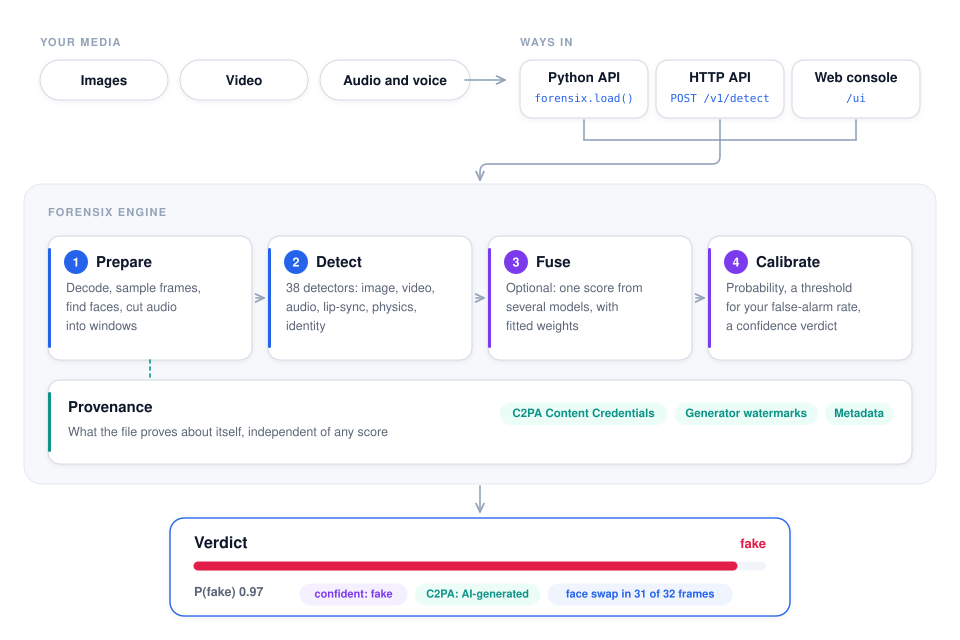
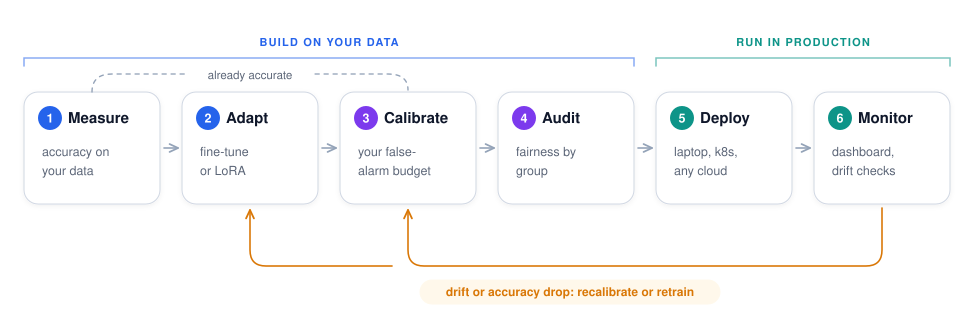

# ForensiX documentation

ForensiX is an end-to-end media forensics platform: it takes you from the first suspicious file
to a calibrated, monitored detection service on your own infrastructure or any major cloud.

- **Detect** manipulated and AI-generated images, video and voices with 38 commercially licensed
  detectors, including face swaps, lip-sync mismatches, cloned voices and physical
  inconsistencies. They all sit behind one API: `forensix.load(name).predict(media)` in Python, or
  `POST /v1/detect` over HTTP.
- **Prove** what a file says about itself: C2PA Content Credentials, generator watermarks,
  metadata.
- **Adapt and trust** the results on your media: fine-tune (including LoRA), calibrate to a
  false-alarm budget, and audit fairness.
- **Run it** as an API and web console: locally, on Kubernetes, or on AWS, Google Cloud and
  Azure with one command or one click. Monitor it live.

## How it works

<picture>
  <source media="(prefers-color-scheme: dark)" srcset="images/diagrams/architecture-dark.svg">
  
</picture>

## From data to production

<picture>
  <source media="(prefers-color-scheme: dark)" srcset="images/diagrams/lifecycle-dark.svg">
  
</picture>

These pages are for engineers who build ForensiX into their products and pipelines. The
[top-level README](../README.md) is the model reference: per-model papers, licenses,
preprocessing details and parity checks against upstream code.

## Start here

| If you want to… | Read |
|---|---|
| Try everything in the browser, with no install: detect, calibrate, evaluate, web manager | [Colab notebook](https://colab.research.google.com/github/anas-rz/ForensiX/blob/main/notebooks/ForensiX_Get_Started.ipynb) |
| Go from a fresh checkout to the running server and web manager in ten minutes | [Quickstart](getting-started.md) |
| Install ForensiX and score your first file | [Installation](guides/installation.md) |
| Understand the building blocks (registry, `Prediction`, score types, families) | [Concepts](concepts.md) |
| Look up a function, class or field | [API reference](api-reference.md) |
| Compare models on commercially usable benchmarks | [Leaderboard](../LEADERBOARD.md) |
| Copy working code for a common task | [Recipes](recipes.md) |
| Call the detectors over HTTP | [HTTP server](server.md) |
| Manage, test and calibrate models in the browser | [Web manager](ui.md) |
| Calibrate models on your own labelled data, and get predictions with confidence | [Calibration](calibration.md) |
| Fine-tune a detector on your data and deploy it to any cloud | [Fine-tuning on your data](guides/finetuning.md) |
| Fine-tune the large CLIP/ViT models with LoRA adapters (PEFT) | [Parameter-efficient fine-tuning](guides/peft.md) |
| Check C2PA credentials, generator watermarks and metadata | [Provenance](provenance.md) |
| Report false-alarm rates by skin tone, age and gender | [Fairness reports](fairness.md) |
| Choose a deepfake detection product: the questions to ask any vendor | [Buyer's checklist](guides/buyers-checklist.md) |
| Run it in Docker, on Kubernetes or a managed cloud | [Docker, Kubernetes and cloud](cloud.md) |
| Deploy on AWS (ECS or EKS) with one command or one click | [Deploying on AWS](aws.md) |
| Deploy on Google Cloud (Cloud Run or GKE) | [Deploying on Google Cloud](gcp.md) |
| Deploy on Azure (Container Apps or AKS) | [Deploying on Azure](azure.md) |
| Run ForensiX as a service over large volumes of media | [Deployment at scale](deployment.md) |

## Guides

| Guide | What it covers |
|---|---|
| [Installation](guides/installation.md) | Python, ffmpeg, GPU, the weights cache, offline machines |
| [Choosing detectors](guides/choosing-detectors.md) | Which detector catches which manipulation; measured results |
| [Interpreting scores](guides/interpreting-scores.md) | `fake_prob`, thresholds, anomaly scores, calibration, localization, `details` |
| [Evaluating on your data](guides/evaluation.md) | The eval scripts, metrics, building a fair test set, reading benchmark numbers |
| [Identity and person models](guides/identity.md) | Enrolling people, verifying media against them, galleries, tiny per-person models |
| [Physics forensics](guides/physics.md) | The physics detectors, forensic reports, learned priors |
| [Parameter-efficient fine-tuning (PEFT)](guides/peft.md) | LoRA adapters with Hugging Face PEFT: train about 1% of a large model's parameters, merge for full-speed serving, deploy to any cloud |
| [Fine-tuning on your data](guides/finetuning.md) | Fine-tune a pretrained detector on your labelled data, evaluate, calibrate, package and deploy it to AWS, Google Cloud or Azure |
| [Training models](guides/training.md) | Training the models that ship without weights (avcons, avid, id-motion, physdf) |
| [Working in Google Colab](guides/colab.md) | GPU choice, Drive, GitHub, Claude Code in Colab |
| [Extending ForensiX](guides/extending.md) | Adding a model or a family, tests, parity checks |
| [Buyer's checklist](guides/buyers-checklist.md) | Vendor-neutral questions to ask any deepfake detection product, with what a good answer looks like |
| [Licensing and compliance](guides/licensing.md) | What the licenses allow, and what to check before shipping |

## Status at a glance

| Family | Models | State |
|---|---|---|
| audio | `aasist`, `aasist-l`, `rawgat-st`, `xlsr-aasist`, `xlsr-aasist-df`, `nes2net-x`, `nes2net-x-itw` | pretrained, parity-checked against upstream |
| image | `univfd`, `rine`, `rine-ldm`, `commfor`, `commfor-224`, `safe`, `clipdet` | pretrained, parity-checked |
| video | `gend`, `gend-pe`, `dfdet-clip`, `dfdc-selim`, `dfdc-wm` | pretrained, parity-checked, [benchmarked on SDFVD](../benchmark.md) |
| audiovisual | `avad`, `syncnet`, `stablesyncnet` | pretrained, parity-checked |
| audiovisual | `avcons`, `avid` | ForensiX models; you train them ([Training](guides/training.md)) |
| identity | `id-face` | pretrained (SFace) |
| identity | `id-motion` | ForensiX model; you train it |
| physics | `phys-bloodflow`, `phys-motion`, `phys-lighting`, `phys-voice`, `phys-room` | algorithmic; `phys-voice` ships a reference fitted on real speech (calibrated scores), the others use provisional ranges until you [fit a reference](guides/physics.md#fit-a-reference-on-your-own-media-recommended) |
| physics | `physdf` | runs without a graph prior; train the prior for the full system |
| specialized | `person-detector` | tiny per-person model you train in seconds |
| provenance | `c2pa`, `watermark-image`, `watermark-audio`, `metadata` | evidence in the file: Content Credentials, SD/SDXL and AudioSeal watermarks, metadata ([Provenance](provenance.md)) |
| multimodal, graph-based | none yet | planned |

`forensix.list_models()` always gives the current list.
