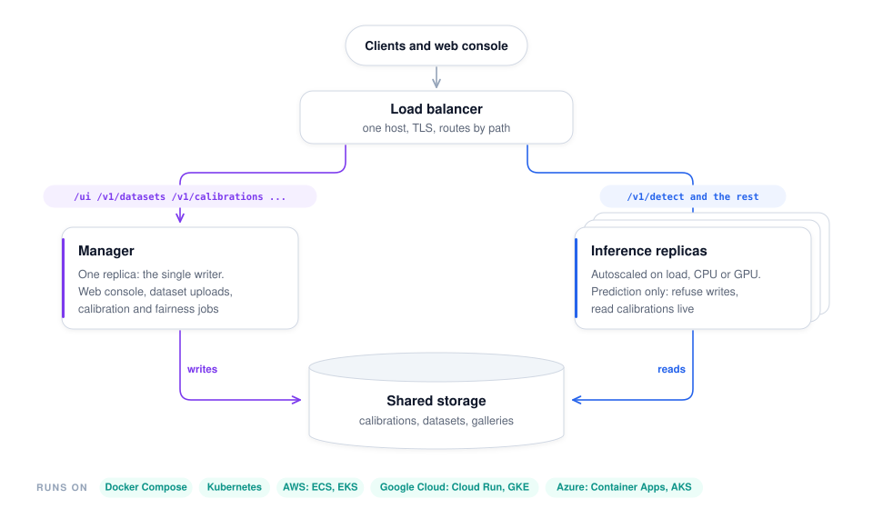

# Docker, Kubernetes and cloud

This guide is for engineers deploying the ForensiX server (API and web manager) as containers:
locally with Docker Compose, on Kubernetes, or on a managed cloud service. For the design of a
large-scale service (queues, worker pools, thresholds, monitoring), see
[Deployment at scale](deployment.md).

| File | What it is |
|---|---|
| [`Dockerfile`](../Dockerfile) | The server image: CPU or GPU, optionally with model weights baked in |
| [`compose.yaml`](../compose.yaml), [`compose.gpu.yaml`](../compose.gpu.yaml) | Docker Compose, CPU and an NVIDIA GPU override |
| [`deploy/forensix.env.example`](../deploy/forensix.env.example) | Keys and settings as environment variables |
| [`deploy/kubernetes/`](../deploy/kubernetes/) | Kustomize base plus `cpu` and `gpu` overlays |
| [`.github/workflows/docker.yml`](../.github/workflows/docker.yml) | CI: tests, image builds, publishing to GHCR on version tags |
| [`deploy/aws/`](../deploy/aws/) | AWS: ECS (Fargate or GPU) and EKS Auto Mode, one command or one click ([Deploying on AWS](aws.md)) |
| [`deploy/gcp/`](../deploy/gcp/) | Google Cloud: Cloud Run (CPU or L4) and GKE Autopilot ([Deploying on Google Cloud](gcp.md)) |
| [`deploy/azure/`](../deploy/azure/) | Azure: Container Apps (CPU or T4) and AKS ([Deploying on Azure](azure.md)) |

## The image

```bash
docker build -t forensix:cpu .
docker build -t forensix:gpu --build-arg TORCH_INDEX=https://download.pytorch.org/whl/cu124 .
docker build -t forensix:cpu-bundled --build-arg MODELS="dfdet-clip commfor nes2net-x-itw syncnet" .
```

| Build arg | Default | Meaning |
|---|---|---|
| `TORCH_INDEX` | CPU wheels | PyTorch wheel index; `cu124` (or the version matching your driver) for NVIDIA GPUs |
| `MODELS` | none | Models whose weights are downloaded, verified and baked into the image |
| `PYTHON_VERSION` | `3.12` | Base image Python |

**Bundled or not.**
- **Bundled images** (`MODELS=...`) start without downloading anything and can run with no
  network access, which is what you want for production. Every container starts from the same
  verified files. Each CLIP-sized model adds about 1.2–1.6 GB.
- **Plain images** download weights on first use into `/opt/forensix/cache`. Mount a volume
  there so they survive restarts.

Bake the same models you preload and use as defaults. If a request needs a model that isn't
baked in, the server tries to download it. On a read-only cache that fails with an error naming
the fix, and the server logs a warning at startup for default models that aren't preloaded.

**Inside the image:**
- **Server:** `python -m forensix.server` on port `$PORT` (default 8000), under `tini`, as
  non-root user 10001.
- **Logs:** JSON lines on stdout (`LOG_FORMAT=json`; set `text` for humans).
- **Writable paths:** `/data` (datasets, calibrations, identity galleries) and `/tmp`. Everything
  else can be read-only.
- **Health:** a Docker `HEALTHCHECK` on `/health`.
- **Shutdown:** in-flight requests get `GRACEFUL_TIMEOUT` seconds (default 30) after SIGTERM.

**Configuration** comes from a JSON file (`FORENSIX_SERVER_CONFIG` or `--config`) and/or
`FORENSIX_SERVER_<FIELD>` environment variables for any field in the
[server configuration](server.md#configuration). Lists can be comma- or space-separated; dicts
are JSON:

```bash
docker run -p 8000:8000 -v forensix-data:/data \
  -e FORENSIX_SERVER_API_KEY=... -e FORENSIX_SERVER_ADMIN_KEY=... \
  -e FORENSIX_SERVER_PRELOAD="commfor dfdet-clip" -e FORENSIX_SERVER_THRESHOLDS='{"dfdet-clip": 0.71}' \
  forensix:cpu-bundled
```

## Docker Compose

```bash
cp deploy/forensix.env.example .env        # set FORENSIX_SERVER_API_KEY and _ADMIN_KEY
docker compose up -d --build               # http://localhost:8000/ui/
docker compose -f compose.yaml -f compose.gpu.yaml up -d --build    # NVIDIA GPU host
docker compose logs -f
```

Compose runs the container read-only with dropped capabilities and a `/tmp` tmpfs. Two named
volumes keep state across restarts: `data` (calibrations, datasets, galleries) and `cache`
(weights).

## Kubernetes

```bash
kubectl create namespace forensix
kubectl -n forensix create secret generic forensix-keys --from-env-file=deploy/forensix.env
kubectl apply -k deploy/kubernetes/overlays/cpu       # or overlays/gpu
kubectl -n forensix get pods -w
```

### What gets deployed

<picture>
  <source media="(prefers-color-scheme: dark)" srcset="images/diagrams/deployment-dark.svg">
  
</picture>

On Kubernetes the shared storage is a ReadWriteMany volume (Filestore on GKE, EFS on EKS, Azure
Files on AKS). On ECS it's EFS; on Cloud Run, a Cloud Storage bucket; on Container Apps, an Azure
Files share.

- **The manager** owns the web UI, dataset uploads, calibration jobs and identity enrollment.
  It runs as a single replica, so shared state has exactly one writer.
- **Inference replicas** serve `/v1/detect` and scale horizontally. With
  `admin_endpoints: false` they refuse writes to shared state (HTTP 409). They read the shared
  volume on every request, so an activated calibration or a new enrollment takes effect on all
  replicas immediately, without restarts.
- **Ingress** routes management paths to the manager and the rest to the replicas. The UI's
  Test page calls `/v1/detect`, so it uses the replicas too.

| Object | Notes |
|---|---|
| ConfigMap `forensix-config` | `server.json`, shared settings. `preload` should match the models baked into the image |
| Secret `forensix-keys` | `FORENSIX_SERVER_API_KEY`, `FORENSIX_SERVER_ADMIN_KEY` (you create it) |
| PVC `forensix-data` | `ReadWriteMany`; set your RWX storage class in the overlay |
| Probes | `startupProbe` on `/ready` (up to 15 min to preload models), `readinessProbe` on `/ready`, `livenessProbe` on `/health` |
| Security | Restricted Pod Security Standard: non-root, read-only root filesystem, no privilege escalation, all capabilities dropped, `RuntimeDefault` seccomp, no service-account token |
| NetworkPolicy | Inbound port 8000; outbound DNS only. Needs a bundled image (no weight downloads) |
| HPA | Inference on CPU utilization (CPU overlay); see below for GPU |
| PodDisruptionBudget | At least one inference replica during node drains |
| Prometheus | Pods carry `prometheus.io/scrape` annotations for `/metrics` |

**Overlays:**
- **`cpu`:** the `cpu-bundled` image, with your RWX storage class and host name.
- **`gpu`:** the `gpu-bundled` image, one `nvidia.com/gpu` per pod for both deployments, GPU
  node selector and toleration, and `device: cuda`. It needs the NVIDIA device plugin (GKE and
  AKS GPU pools include it; on EKS install the NVIDIA GPU operator).

Copy an overlay and edit the image registry, host, TLS secret and storage class for your
cluster.

**Sizing.**
- **CPU pods:** request 4 CPUs and 12 GiB, with a 16 GiB limit; that holds the four default
  models with headroom.
- **GPU pods:** a 24 GB L4 fits the defaults. CPU-side work (decoding, face detection) still
  matters there, so keep 4+ CPUs per GPU pod.
- **Autoscaling on GPU:** GPU pods don't produce useful CPU-utilization signals. Scale them on
  request rate instead, e.g. `rate(forensix_requests_total[2m])` through prometheus-adapter or
  KEDA.

**Startup time.** A new replica takes minutes to load models (more on CPU). The HPA scales down
slowly (10-minute window) so replicas don't flap. Pre-pull the image on GPU node pools if your
platform supports it (e.g. GKE image streaming).

## Managed clouds

Each cloud has a one-command, one-click deployment that sets all of this up:

- [AWS](aws.md): ECS on Fargate or GPU instances, or EKS Auto Mode.
- [Google Cloud](gcp.md): Cloud Run (CPU or L4), or GKE Autopilot.
- [Azure](azure.md): Container Apps (CPU or T4), or AKS.

| | GKE | EKS | AKS |
|---|---|---|---|
| RWX storage class | Filestore CSI (`standard-rwx`) | EFS CSI driver (`efs-sc`) | Azure Files (`azurefile-csi`) |
| GPU nodes | L4 node pool (`g2-standard-8`), node selector `cloud.google.com/gke-accelerator: nvidia-l4` | `g6.2xlarge` (L4) node group + NVIDIA GPU operator | `Standard_NC4as_T4_v3` / NC A100 pools |
| Registry | Artifact Registry | ECR | ACR |
| Ingress | GKE Ingress or ingress-nginx | AWS Load Balancer Controller or ingress-nginx | Application Gateway or ingress-nginx |

The base Ingress targets ingress-nginx (its upload size and timeout annotations matter for
dataset ZIPs). On other controllers, set the equivalent body-size and read-timeout limits.

### Cloud Run (no cluster)

[Deploying on Google Cloud](gcp.md) automates this, with a separate manager service and shared storage.

A single container works on Cloud Run, with CPU or an NVIDIA L4 GPU:

```bash
gcloud run deploy forensix --image REGION-docker.pkg.dev/PROJECT/forensix/forensix:gpu-bundled \
  --gpu 1 --gpu-type nvidia-l4 --cpu 8 --memory 32Gi --no-cpu-throttling \
  --min-instances 1 --max-instances 4 --concurrency 8 --timeout 900 \
  --set-env-vars FORENSIX_SERVER_DEVICE=cuda,FORENSIX_SERVER_PRELOAD="dfdet-clip commfor nes2net-x-itw syncnet" \
  --set-secrets FORENSIX_SERVER_API_KEY=forensix-api-key:latest,FORENSIX_SERVER_ADMIN_KEY=forensix-admin-key:latest
```

- **Port:** Cloud Run sets `PORT`, which the server uses.
- **Instances:** `--min-instances 1` avoids cold starts, which take minutes to load models.
  `--no-cpu-throttling` keeps calibration jobs running between requests.
- **State:** the container filesystem is lost when an instance stops, so calibrations need
  storage. Either mount a Cloud Storage bucket at `/data` (Cloud Run volume mounts), or keep
  calibration on a separate always-on manager and run Cloud Run instances as prediction-only
  (`FORENSIX_SERVER_ADMIN_ENDPOINTS=false`) with the same bucket mounted.

## Observability

- **Metrics:** `/metrics` (Prometheus text format):
  - server: `forensix_ready`, `forensix_uptime_seconds`, `forensix_models_loaded`;
  - per model: `forensix_requests_total`, `forensix_errors_total`, `forensix_cache_hits_total`,
    `forensix_busy_seconds_total`, `forensix_load_seconds`, `forensix_batches_total`,
    `forensix_batched_items_total`;
  - calibration: `forensix_jobs{status}`, `forensix_calibration_active_version{model}`.

  Mean latency per model is `rate(busy_seconds_total) / rate(requests_total)`. Turn the endpoint
  off with `metrics: false`.
- **Logs:** JSON lines with `time`, `level`, `logger`, `message`, ready for Cloud Logging,
  CloudWatch, Loki or Elasticsearch.
- **Health:** `/health` (process up) and `/ready` (preloaded models in memory).
- **Web UI:** the Overview page shows the instance it's served from. On Kubernetes that's the
  manager, so use Prometheus for fleet-wide numbers.

## Security checklist

- [ ] API and admin keys set, from a Secret manager, never in images or ConfigMaps.
- [ ] TLS terminated at the Ingress or load balancer; plain HTTP only inside the cluster.
- [ ] Bundled image plus the NetworkPolicy: no egress from pods that decode untrusted media.
- [ ] Read-only root filesystem, non-root user, dropped capabilities (all in the manifests).
- [ ] Images rebuilt regularly for ffmpeg, OpenCV and Python security fixes; scan them in your
      registry.
- [ ] `/data` access restricted. It holds identity galleries (biometric data) and your labelled
      datasets.
- [ ] Upload and dataset size limits (`max_upload_mb`, `max_dataset_mb`) and Ingress body
      limits set to what you need.

## What's been verified

- **Server runtime, run locally as the container runs it:**
  - environment-only configuration, `PORT`, JSON logs;
  - `--warm-only` filling a cache with verified, stamped files, and exiting 1 on a model that
    can't load;
  - serving from a read-only cache, with an actionable error for missing weights;
  - prediction-only replicas refusing writes;
  - `/metrics`;
  - graceful SIGTERM shutdown;
  - a manager and a replica sharing a calibration directory (automated test).
- **Kubernetes manifests:** both overlays were rendered with a Python implementation of the
  Kustomize steps used here, and their links checked (selectors, Services, Ingress backends,
  volumes, ConfigMap and PVC references, the GPU patch, the restricted security settings).
- **Not yet:** building the image (this repo's development machine has no Docker access) and
  applying the manifests to a cluster. Run `docker compose up --build` and
  `kubectl apply -k --dry-run=server` on your side, or let CI build the image on the next pull
  request.
