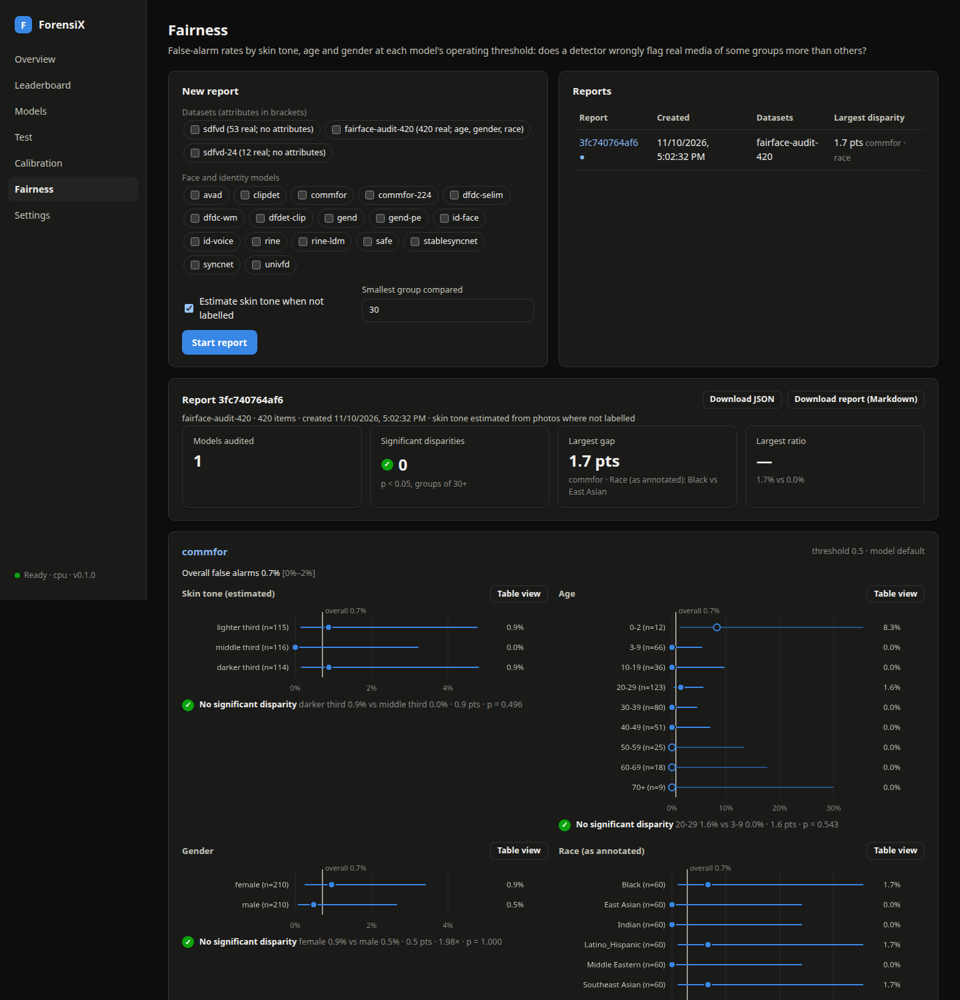

# Fairness reports

A detector that flags real people as fake more often when they have darker skin, are older, or are
women causes real harm, and buyers and regulators (the EU AI Act, NIST's face-analysis guidance,
procurement questionnaires) ask for evidence that it doesn't. A ForensiX fairness report measures
**false-alarm rates by skin tone, age and gender** (and any other attribute you label) for any
image, video or identity model, at the threshold the model actually runs at.

## What it measures

For each model and each attribute (for example `gender`), the report gives, per group:

| Measure | Meaning |
|---|---|
| **False-alarm rate** | Share of the group's *real* items the model flags as fake, with a 95% Wilson interval. The main number |
| **Detection rate** | Share of the group's *fake* items caught, when the dataset has fakes |
| **AUC** | Per-group ranking quality, when the group has both real and fake items |
| **Reliable** | Whether the group has at least `min_group` real items (default 30) |

and a **disparity** across the reliable groups: the highest and lowest false-alarm rates, their
difference and ratio, and a two-sided Fisher exact test of whether the gap could be chance
(**significant** at p < 0.05). Groups below `min_group` are still shown, marked ⚠, but left out of
the comparison: 1 false alarm in 8 people is not evidence of anything.

**The threshold matters.** Rates are measured at the model's operating point: its active
calibration's threshold ("calibration vN"), else the server's configured threshold ("server
config"), else the model default. The report records which was used. Re-run it after you
recalibrate.

Provenance models (`c2pa`, watermarks, `metadata`) read file evidence, not faces, and are rejected.

## The dataset

Any [ForensiX dataset](calibration.md#the-dataset-format) with demographic columns in its manifest:

```csv
file,label,group,skin_tone,age,gender,attr_region
media/p001.jpg,real,p001,4,34,female,south-asia
media/p002.jpg,real,p002,9,61,male,west-africa
media/p002_swap.jpg,fake,p002,9,61,male,west-africa
```

| Column | Values | Grouped as |
|---|---|---|
| `skin_tone` | Monk 1-10 or Fitzpatrick I-VI | Monk 1-3 / 4-7 / 8-10; Fitzpatrick I-II / III-IV / V-VI |
| `age` | years, or a band such as `20-29` | 0-17, 18-29, 30-44, 45-59, 60+ (bands are kept as given) |
| `gender` | any label | as given, lower-cased |
| `attr_<name>` | any label | as given, reported as `<name>` |

Real items drive the false-alarm rates, so a fairness set can be all real. Aim for at least 30,
better 100+, real items per group; with 30 the interval on a 5% rate is roughly 1–17%.

### No skin-tone labels? Estimate them

With `estimate_skin_tone` on (the default) and no `skin_tone` column, ForensiX estimates each
face's **Individual Typology Angle** (ITA, from the CIELAB colour of the cheeks and forehead, found
with the YuNet face detector) and groups the dataset into **terciles**: lighter, middle and darker
third. Faces that are greyscale, in profile or too small are left out.

Treat this as a proxy, not a measurement. Lighting, white balance and make-up move ITA a lot, so
the tercile labels are relative to *this* dataset, never absolute skin types. Use annotated Monk
labels for anything you publish. On FairFace, faces annotated Black fall in the darker third 55% of
the time and in the lighter third 12%; that's useful for screening but noisy.

### A ready audit set: FairFace

[FairFace](https://github.com/joojs/fairface) (CC BY 4.0) has real face photos annotated with age
band, gender and race. [scripts/build_fairface_set.py](../scripts/build_fairface_set.py) builds a
balanced audit set (default 30 per race × gender cell, 420 images) from its validation split; the
script's docstring has the download command. Race is FairFace's annotation and is reported as
`race`. It is not skin tone.

## Running a report

**Web manager:** open **Fairness**, pick the dataset and models, and start. The report shows, per
model and attribute, each group's false-alarm rate and interval against the overall rate, with
disparity verdicts, and downloads as Markdown or JSON.



**HTTP:**

```bash
curl -X POST localhost:8000/v1/fairness -H "X-API-Key: $ADMIN" -H "Content-Type: application/json" \
  -d '{"dataset": "19065db78962", "models": ["commfor", "univfd"], "estimate_skin_tone": true, "min_group": 30}'
# → 202 {"id": "f6f17dfe2b81", ...}; follow GET /v1/jobs/{id}
curl localhost:8000/v1/fairness/f6f17dfe2b81?format=markdown -H "X-API-Key: $KEY" > fairness.md
```

| Field | Default | Meaning |
|---|---|---|
| `dataset` or `datasets` | | One dataset id, or several pooled |
| `models` | | Image, video or identity models |
| `estimate_skin_tone` | `true` | Estimate ITA terciles when there's no `skin_tone` column |
| `min_group` | `30` | Real items a group needs to enter the disparity comparison |
| `attributes` | `skin_tone`, `age`, `gender`, `race` | Which attributes to report |

`GET /v1/fairness` lists saved reports. They are kept in the calibration directory with the
datasets they came from.

**Python:**

```python
from forensix.fairness import report, to_markdown

items = [{"label": "real", "attributes": {"gender": "female", "age": "34"}, "scores": {"commfor": 0.12}}, ...]
rep = report(items, {"commfor": {"threshold": 0.5, "threshold_source": "model default"}})
print(to_markdown(rep))
```

## Reading a report honestly

- A **significant** disparity is a finding: say which groups, by how much, at which threshold.
  Not significant means the data can't show a gap, not that there is none. Check how wide the
  intervals are.
- False alarms depend on the *images* as much as the people: camera, compression and lighting differ
  between sources, so collect every group from comparable sources.
- Recalibrating moves the threshold for everyone. Lowering one group's false alarms with a
  per-group threshold is a policy decision with legal implications; ForensiX doesn't do it for you.
