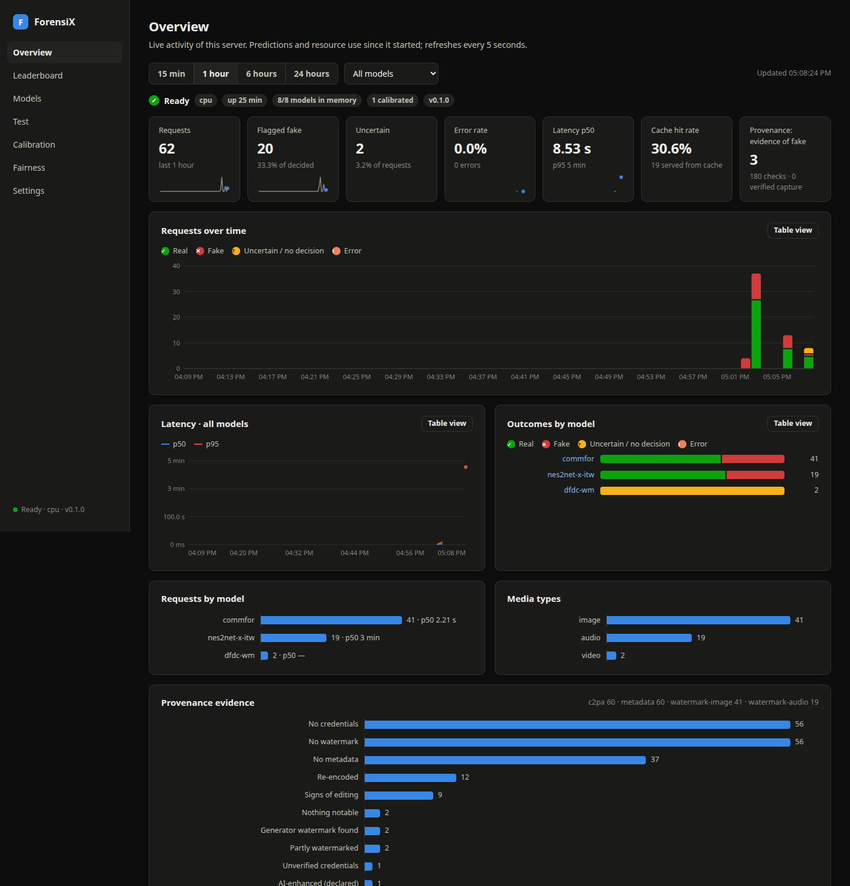
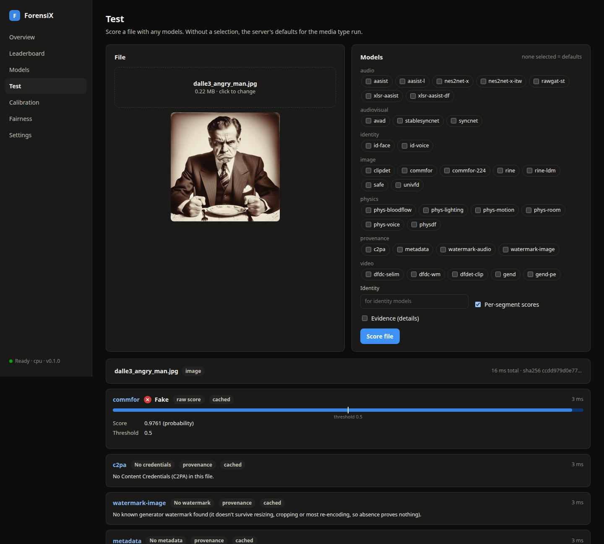
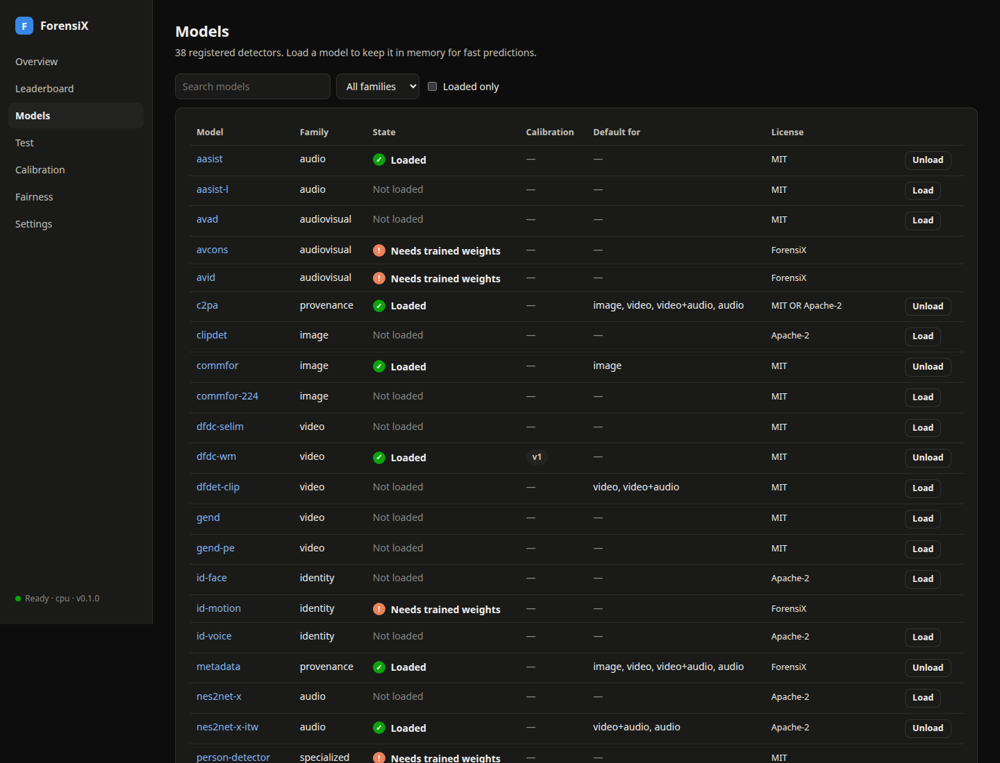
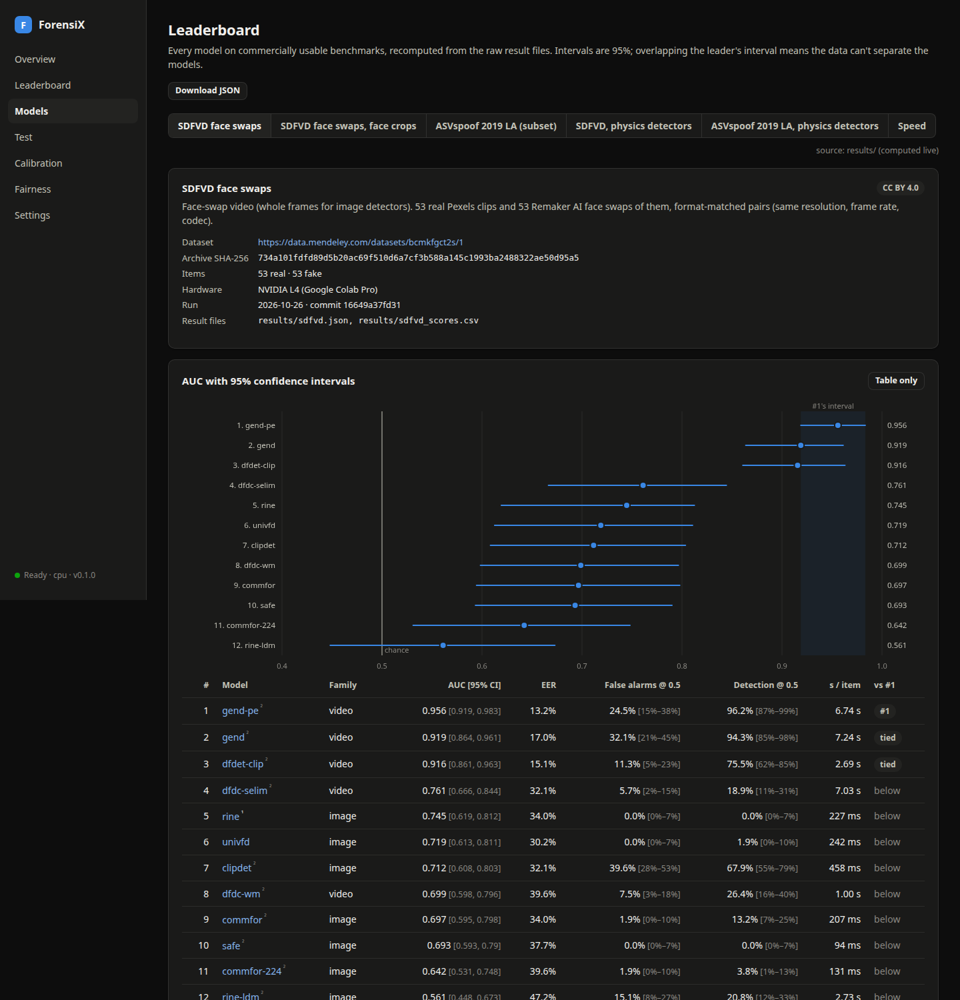
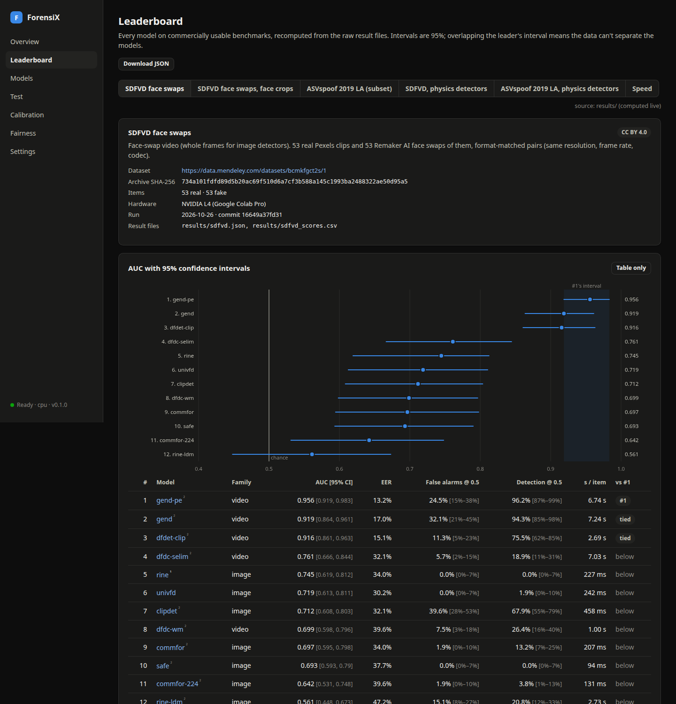
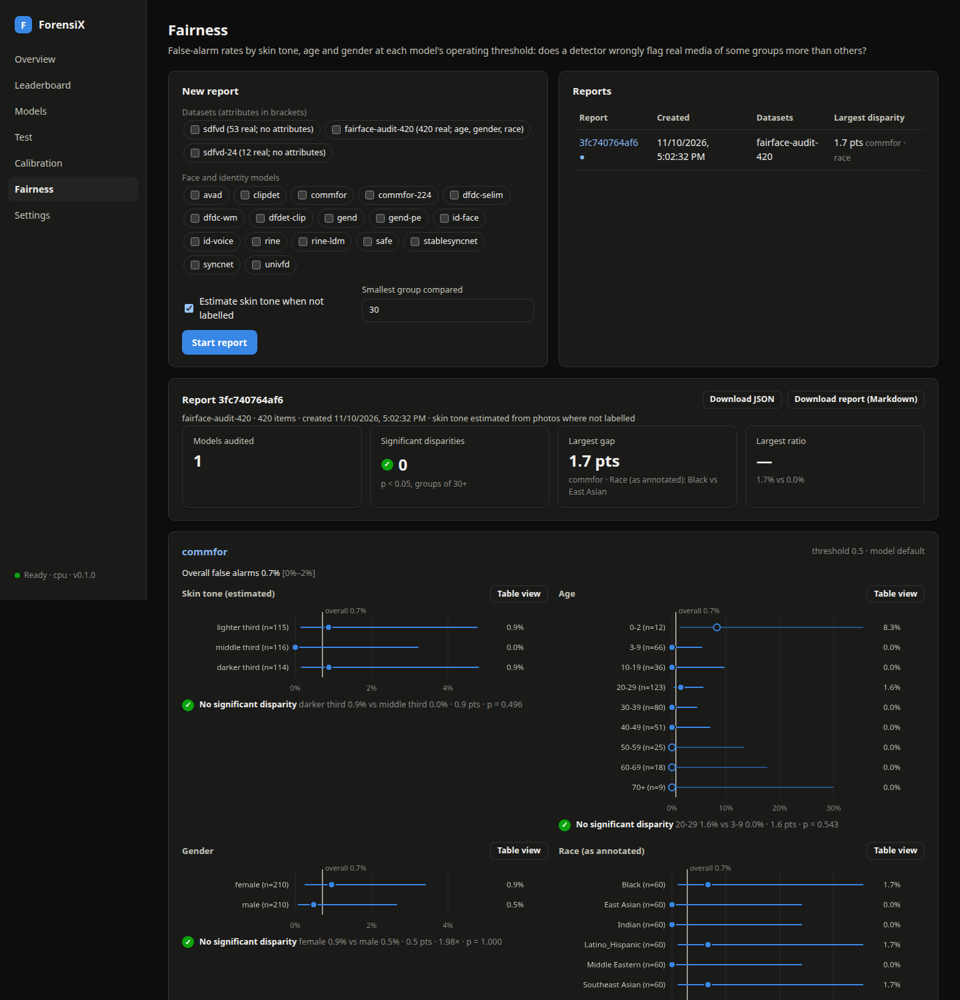

# Quickstart

This page takes you from a fresh checkout to scoring files in Python, over HTTP and in the web
manager, in about ten minutes. Each step links to the page that covers it in depth.

## 1. Install

You need Python 3.10 or newer and ffmpeg ([Installation](guides/installation.md) has the details
and GPU notes).

```bash
git clone https://github.com/anas-rz/ForensiX.git
cd ForensiX
pip install -e ".[server]"        # the library, the HTTP server and the provenance checks
```

Model weights download on first use into `~/.cache/forensix/` and are checked against a SHA-256
hash. To fetch them ahead of time, for example before going offline, run
`python scripts/download_weights.py`.

## 2. Score a file in Python

```python
import forensix

forensix.list_models("image")                  # ['clipdet', 'commfor', 'commfor-224', 'rine', ...]

detector = forensix.load("commfor")            # device="cuda" on a GPU
pred = detector.predict("photo.jpg")
pred.fake_prob, pred.label                     # (0.98, 'fake')
```

Every detector, whether for audio, images, video, lip sync, physics or identity, returns the same
[`Prediction`](api-reference.md#prediction). [Choosing detectors](guides/choosing-detectors.md)
explains which detector catches which manipulation, and
[Interpreting scores](guides/interpreting-scores.md) explains what a score means.

Provenance checks read the evidence the file itself carries: Content Credentials, generator
watermarks and metadata.

```python
report = forensix.provenance.check("photo.jpg")
report["verdict"], report["summary"]           # ('no_decisive_evidence', 'No decisive provenance evidence (most files carry none; ...)')
```

## 3. Run the server

```bash
python -m forensix.server --preload commfor nes2net-x-itw
```

The first start downloads the preloaded models. Once it logs `Uvicorn running on
http://0.0.0.0:8000`, the models are in memory and requests pay only for inference:

```bash
curl -F file=@photo.jpg http://localhost:8000/v1/detect
curl -F file=@clip.mp4 -F models=dfdet-clip,syncnet http://localhost:8000/v1/detect
```

Without `models`, the server picks the defaults for the media type: a detector plus the provenance
checks. Before exposing the server, set an API key (`--api-key`, or `api_key` and `admin_key` in a
config file). [HTTP server](server.md) covers the endpoints, configuration, batching and security.
The interactive OpenAPI docs are at `http://localhost:8000/docs`.

For a repeatable setup, put the options in a JSON config. A `calibration_dir` keeps uploaded
datasets, calibrations and fairness reports across restarts:

```json
{
  "device": "cuda",
  "preload": ["commfor", "dfdet-clip", "nes2net-x-itw", "syncnet"],
  "calibration_dir": "/data/forensix/calibration",
  "api_key": "change-me",
  "admin_key": "change-me-too"
}
```

```bash
python -m forensix.server --config server.json
```

## 4. Use the web manager

Open **http://localhost:8000/ui/**. It's served by the same process and calls the same API, so
anything you do there can be scripted. If you set keys, enter them under **Settings** first.

**Overview** is a live dashboard of the instance: requests, verdicts, latency, cache hits and
resource use, for all models or one.



**Test**: drop in an image, video or audio file and pick models, or use the defaults. Each model
shows its score against its threshold, and the provenance checks show what the file itself proves.



**Models** lists every registered detector: whether it's loaded, its license and its
calibration. Load or unload models from here, and open one to see its versions and performance.



**Calibration**: upload a labelled dataset as a ZIP (`real/` and `fake/` folders, or a
`manifest.csv`) and calibrate models on it. You get calibrated probabilities, a threshold for a
target false-alarm rate, and confidence verdicts on every prediction. [Calibration](calibration.md)
explains the dataset format and the full, incremental and refit modes.



**Leaderboard**: every model on commercially usable benchmarks, with 95% confidence intervals.



**Fairness**: false-alarm rates by skin tone, age and gender for face and identity models
([Fairness reports](fairness.md)).



## 5. Run it in a container

```bash
docker compose up -d --build                        # server and web manager on port 8000
kubectl apply -k deploy/kubernetes/overlays/cpu     # or overlays/gpu
```

[Docker, Kubernetes and cloud](cloud.md) covers images, GPUs, persistence and autoscaling, and
[Deployment at scale](deployment.md) covers running ForensiX over large volumes of media.

## Next steps

- [Recipes](recipes.md): working code for common tasks, such as checking a talking-head video
  across modalities, finding the fake part of a long recording, or choosing a threshold.
- [Evaluating on your data](guides/evaluation.md): measure detectors on your own media before you trust them.
- [Licensing and compliance](guides/licensing.md): what the bundled licenses allow.

## Building these docs

The documentation is a [MkDocs](https://www.mkdocs.org/) site with the Material theme:

```bash
pip install -e ".[docs]"
mkdocs serve          # live preview at http://127.0.0.1:8000 (use -a 127.0.0.1:8001 if the ForensiX server is running)
mkdocs build          # static site in site/
```
