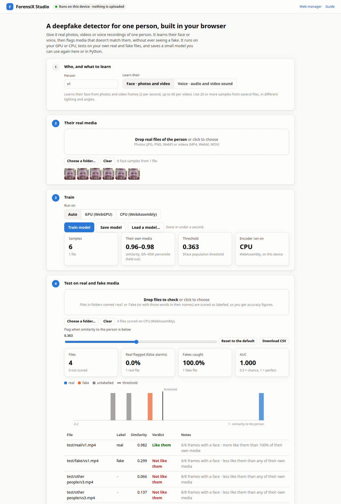

# Studio: a detector for one person, in your browser

ForensiX Studio builds a deepfake detector for one person from their real photos, videos or voice
recordings, then tests it on real and fake files. It runs in a browser tab on your own GPU or CPU.
Nothing is uploaded, and you don't need to install anything.

It's for anyone protecting a specific person, such as an executive, a public figure or yourself.
It flags media that doesn't match that person's real face or voice, and it never needs to see a
fake.

- **Open it from the docs site:** [anas-rz.github.io/ForensiX/studio/](https://anas-rz.github.io/ForensiX/studio/)
- **Or from your own server:** `http://localhost:8000/ui/studio/` (the web manager links to it as
  **Studio**)



*Enrolled from one real clip. The face swap made from that clip and two other people's clips score
far below the person and are flagged; the person's own clip passes. Clips from
[SDFVD](https://data.mendeley.com/datasets/bcmkfgct2s/1) (CC BY 4.0).*

## Four steps

1. **Who, and what to learn.** Name the person and choose **Face** (photos and video) or **Voice**
   (audio, or the sound of videos).
2. **Their real media.** Drop in files or a folder of real media of the person. For faces, use 20
   or more samples from several files, with different lighting and angles. For voice, use a few
   minutes of speech from more than one recording session. Each file is read on your device: two
   frames per second (up to 60 per video), or speech in 3-second segments.
3. **Train.** Choose **Auto**, **GPU (WebGPU)** or **CPU (WebAssembly)**. The encoders download
   once and are then cached: about 39 MB for faces and 83 MB for voice. Training takes under a
   second, because it learns the person's profile rather than a new network. Click **Save model**
   to download it as a small JSON file. **Load a model…** opens one again.
4. **Test.** Drop in files to check. Files in folders named `real` and `fake`, or with those words
   in their names, count as labelled, and the page shows:
    - **for each file:** its similarity to the person, a verdict, and how it compares with the
      person's own media;
    - **for labelled sets:** the false-alarm rate, the share of fakes caught, AUC, and a histogram.

    Move the slider to try other thresholds, and download the scores as CSV.

## What the score means

The **similarity** runs from about 0 (nothing like them) to 1 (just like them). It's the median,
over a file's frames or speech segments, of how closely each matches the person's profile.

| Similarity | Faces (SFace) | Voices (ECAPA) |
|---|---|---|
| Default threshold: below this, "Not like them" | 0.363 | 0.25 |
| Where these thresholds come from | OpenCV Zoo, measured on LFW | SpeechBrain's verification default |

These thresholds are the encoders' published ones, not values fitted to your few files. The
benchmark explains why: a threshold set from one person's media flagged a third of their real
frames. The **Their own media** tile shows the range of similarities of the person's own media,
each file scored against a profile built without it. The test table also says how a file compares
with that range.

## Use the model in Python, or on a server

A model saved in the Studio is the same file that
[`person-anomaly`](identity.md#person-anomaly) reads and writes:

```python
import forensix

det = forensix.load("person-anomaly", weights_path="alice.face.forensix.json")
pred = det.predict("new_video.mp4")
pred.is_fake, pred.details["similarity"], pred.details["person_percentile"]
```

The browser and Python versions run the same networks with the same preprocessing, and gave the
same verdicts on the test files:
- **Voice:** the embeddings matched to a cosine of 1.000.
- **Faces:** they matched to 0.97–0.99. The small differences come from image resizing in the
  browser.

`scripts/check_studio.py` re-runs this comparison on your own files.

## How well it works

Measured on people the detector never saw before enrolling them, with the default thresholds
([full benchmark](../../person_anomaly_benchmark.md)):

| Data | AUC | Real flagged | Fakes caught |
|---|---|---|---|
| Face swaps (SDFVD), per video | 0.99 | 2% (1 of 53) | 77% |
| Voice spoofs (ASVspoof 2019 LA), per clip | 0.91 | 0% | 19% |

Read these numbers with their limits:

- **Same session:** the face test enrolls and tests on the same short video. Real footage from
  another day, camera or lighting will be less similar.
- **Thresholds trade catches for false alarms:** the default thresholds rarely flag real media,
  including real speech from another recording session. For voice, a threshold of 0.5 instead of
  0.25 caught 45% of spoofs and flagged 1–2% of real clips. Pick yours on labelled files of your
  own, which the Test step lets you do.
- **Good fakes get through:** a face swap or voice clone that fully reaches the person's identity
  is *built* to pass this check. Pair the Studio with a deepfake detector that looks at how the
  media was made.

### Why nothing is trained from scratch

The first design trained a small autoencoder (about 100–230k parameters) on each person's face
crops or voice spectrograms, to flag what it couldn't reconstruct. It ran in the browser on
WebGPU, but in the benchmark it scored near chance (AUC 0.40–0.57), both trained from scratch and
fine-tuned from a model trained on other people's real media. Adding it to the identity score made
the identity score *worse*. The Studio therefore ships what measured best: pretrained encoders and
the person's profile.

## Privacy and requirements

- **Where things run:** media, embeddings and models stay in the tab. The page downloads only
  code and model weights:
    - **libraries:** onnxruntime-web (MIT), from jsDelivr;
    - **face models:** YuNet and SFace (OpenCV Zoo), from Hugging Face;
    - **voice model:** ECAPA, from the same site as the page.
- **What a saved model contains:** the person's average embedding. That's biometric data, so store
  and delete it under the rules that apply to you (GDPR, BIPA and similar).
- **Browser:** a current Chrome, Edge or Firefox; Safari 17 or newer. **GPU (WebGPU)** needs a
  browser and graphics driver with WebGPU, and Auto falls back to CPU without it.
- **Video formats:** browsers decode H.264, VP9 and AV1. Convert older files, such as MPEG-4 Part
  2 `.mp4` or `.avi`, with `ffmpeg -i in.mp4 -c:v libx264 -crf 18 out.mp4`.
- **The page:** open it over `http(s)`, not by double-clicking the file. Its voice model is served
  next to it, so a static copy needs `studio/models/ecapa.onnx`. Export it with
  `python -c "from forensix.identity.anomaly import export_ecapa_onnx; export_ecapa_onnx('studio/models/ecapa.onnx')"`.

**Next step:** enroll several people and test them against each other in
[Identity and person models](identity.md#evaluating-identity-detectors).
